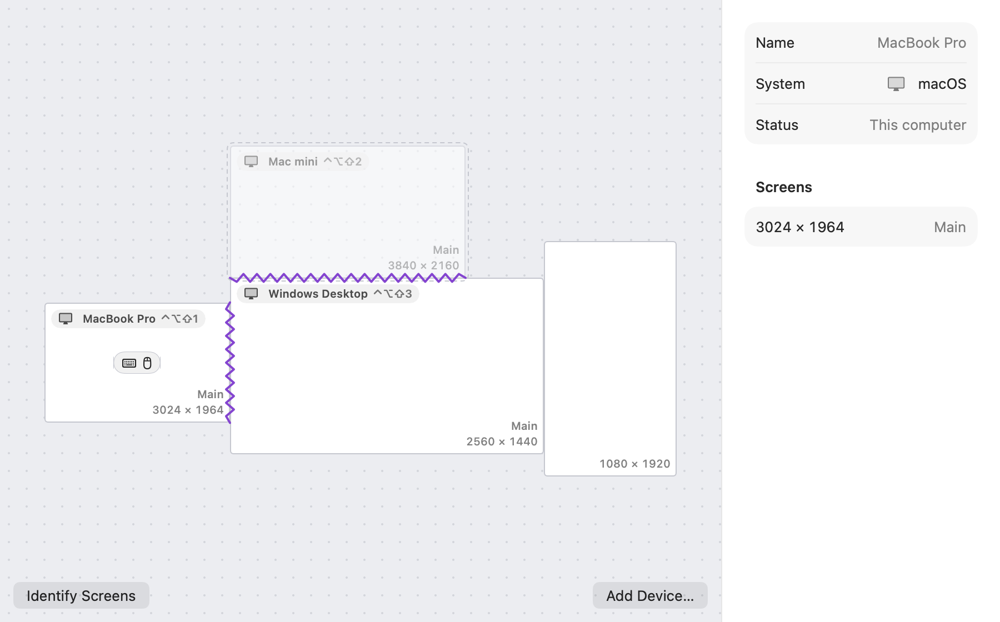
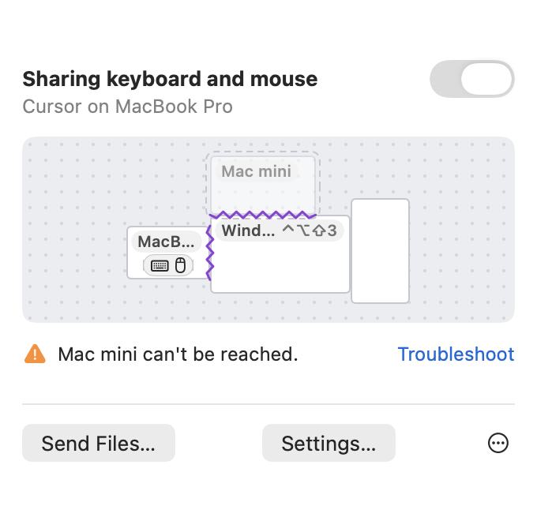
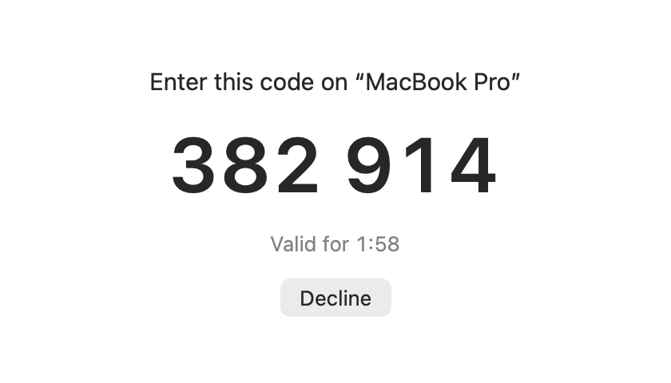

**English** · [繁體中文](README.zh-TW.md)

<picture>
  <source media="(prefers-color-scheme: dark)" srcset="docs/brand/logo-dark.svg">
  
</picture>

**One keyboard and mouse for every computer on your desk.** Move the pointer past the edge of one screen and it carries on, with the keyboard, on the computer next to it. Copy on one computer and paste on another, and send files between them. InputWeave works between macOS, Windows and Linux, over your local network.

Website: <https://inputweave.ctsite.cc/>

<a href="https://alternativeto.net/software/inputweave/about/?utm_source=badge&amp;utm_medium=referral"></a>

## Why InputWeave

- **No account, no cloud, local network only.** Your computers find each other on the local network and connect directly. Keystrokes, the clipboard and files never pass through a server.
- **Encrypted and paired.** Every connection uses mutual TLS over QUIC, pinned to each computer's own certificate. A new computer joins with a 6-digit pairing code shown on its screen: no fingerprints to compare, no configuration files to edit.
- **Clipboard and files built in.** Copy on one computer and paste on the one the pointer moves to: plain and formatted text and images, and files copied in Finder or File Explorer. Drag files across the edge of the screen between a Mac and a PC, or drop them on a computer in the app.
- **The Windows sign-in screen and UAC prompts** can be used from another computer, through the InputWeave system service.
- **Native apps.** A SwiftUI menu bar app on macOS, a WinUI 3 notification area app on Windows, a GTK 4 / libadwaita app on Linux.
- **Free and open source**, under the GNU GPL, version 3 or later.

## Screenshots

<picture>
  <source media="(prefers-color-scheme: dark)" srcset="docs/screenshots/arrangement-dark.png">
  
</picture>

<picture>
  <source media="(prefers-color-scheme: dark)" srcset="docs/screenshots/panel-dark.png">
  
</picture>


The Arrangement page, the menu bar panel and the pairing code a new computer shows, from the macOS app. The images come from the app's offscreen snapshots (see [`docs/screenshots`](docs/screenshots/README.md)).

## How it works

Each computer runs a small background service, and the app talks to it. On the Arrangement page you drag each computer to where it sits on your desk; where two screens meet, a seam appears, and that is where the pointer crosses. Push the pointer through the seam and it continues on the other computer, with your keystrokes following it. The computer whose keyboard and mouse you are using leads: it keeps one pointer across every screen in the arrangement and tells the computer under it where to put it.

Press ⌃⌥⇧⎋ (Ctrl + Alt + Shift + Esc on Windows and Linux) to take back control at any time; if a connection drops, the keyboard and mouse come back by themselves. ⌃⌥⇧L locks the pointer to the computer it is on, ⌃⌥⇧1 to ⌃⌥⇧9 jump straight to a computer, ⌃⌥⇧G switches to relative mouse for games, and all of these can be changed in the app's settings. The architecture is described in [`docs/architecture.md`](docs/architecture.md), and the [user guide](docs/user-guide.md) covers everything in detail.

## Requirements

| | Requirements |
|---|---|
| macOS | macOS 15 or later, Apple silicon or Intel |
| Windows | Windows 10 22H2 or Windows 11, x64 |
| Linux | Ubuntu 24.04 or later, or Debian 13, amd64 or arm64; X11 or Wayland (GNOME, KDE Plasma, sway, Hyprland, river) |

All the computers must be on the same local network, and each needs InputWeave installed.

## Installing

Download the installer for each computer from the [latest release](https://github.com/tasict/InputWeave/releases/latest).

- **macOS:** open `InputWeave-<version>.pkg` and follow the steps. The installer is signed with a Developer ID and notarized by Apple. The first launch walks you through setup, including the Accessibility and Input Monitoring permissions. New versions are offered inside the app.
- **Windows:** run `InputWeave-<version>-x64.msi`. It installs the InputWeave service and the app, and allows InputWeave through the firewall for the local network. The installer is not code-signed yet, so Windows may ask you to confirm. New versions are offered inside the app (Settings › General › Updates).
- **Linux:** install the package for your computer's architecture:

  ```sh
  sudo apt install ./inputweave_<version>_amd64.deb   # or _arm64.deb
  ```

  The package adds InputWeave's package source, so later versions arrive with your system's software updates (Software, Discover or `apt upgrade`). The background service starts at your next sign-in.

Then pair the computers: on one of them open Settings › Devices › Add Device…, choose the other, and type the 6-digit code it shows.

## The license

InputWeave is free software, and every feature works without a license, with no time limit. Until you add a license, Settings and About say **Trial**. A license costs US$10, paid once, and replaces that with a **Licensed** label on up to 5 of your computers; enter the key on one computer, then on its License page choose which of your paired computers use it. Nothing else changes. Licenses are sold through [Polar](https://polar.sh/), and the [license page](https://inputweave.ctsite.cc/license.html) has the details. You can also build InputWeave yourself under the GPL.

## Status

The current version has been tested by hand on macOS, Windows and Linux.

- **Mac lock screen and login window:** since 1.1.1, other computers can type and click on a locked Mac, through a virtual keyboard and mouse (Apple has granted the permission this needs), and at the login window when that is turned on in Settings › General › Lock Screen. This is new and hasn't been tested by hand as much as the rest.
- **Linux:** dragging files across computers isn't supported (use Send Files, drop them on a computer in the app, or copy and paste files in the file manager). On GNOME's Wayland session the screen-edge glow isn't shown, and the desktop asks once per sign-in before this computer's keyboard and mouse can control other computers.
- **Windows:** the installer isn't code-signed yet.

## How it compares

| | macOS, Windows and Linux | Open source | No account | Pairing code | Clipboard | File transfer | Windows sign-in screen / UAC |
|---|---|---|---|---|---|---|---|
| **InputWeave** | ✓ | ✓ GPL-3.0 | ✓ | ✓ 6 digits | ✓ | ✓ | ✓ |
| Universal Control | ✗ Apple devices only | ✗ | – | – | ✓ | ✓ drag and drop | – |
| Mouse Without Borders | ✗ Windows only | ✓ MIT | – | – | ✓ | ✓ | – |
| Synergy 3 / ShareMouse | – | ✗ commercial | – | – | ✓ | varies by product | – |
| Deskflow / Barrier | – | ✓ GPL-2.0 | – | – | ✓ | ✗ | – |
| lan-mouse | – | ✓ GPL-3.0 | – | trusts certificate fingerprints | – | ✗ | – |

✓ yes · ✗ no · – not covered by this comparison; check that project's own documentation.

## Build from source

See [CONTRIBUTING.md](CONTRIBUTING.md) for building and testing on each platform. In short:

```sh
cargo build --workspace
cargo test --workspace

# The macOS app (builds and embeds the Rust agent); needs Xcode 26 and XcodeGen
xcodegen generate --spec apps/macos/project.yml
xcodebuild -project apps/macos/InputWeave.xcodeproj -scheme InputWeave test
```

To try the protocol and routing without touching your real keyboard and mouse, run an agent with `backend.kind = "mock"` on any platform and drive it with `inputweave ctl`. The configuration format is described at the top of `crates/inputweave/src/config.rs`.

## Repository layout

| Path | Contents |
|---|---|
| `crates/iw-core` | State machines without I/O: arrangement geometry, routing, the receiving side, clipboard hand-off |
| `crates/iw-net` | QUIC, identity and certificates, pairing, mDNS |
| `crates/iw-platform` | Input, display and clipboard backends for each platform |
| `crates/iw-winsvc` | The Windows service and broker |
| `crates/inputweave` | The single executable: `agent`, `ctl`, `service`, `broker` |
| `proto/` | Protobuf schemas for IPC and the peer protocol |
| `apps/macos`, `apps/windows`, `apps/linux` | The native apps |
| `packaging/` | The Windows installer (WiX) and the Linux packages |
| `site/` | The website |
| `docs/` | Architecture, user guide, brand assets, screenshots, release notes |

## Contributing and security

Contributions are welcome; please read [CONTRIBUTING.md](CONTRIBUTING.md) first (contributions need the [contributor license agreement](CLA.md)). To report a security problem, see [SECURITY.md](SECURITY.md).

## License

Copyright © 2026 InputWeave contributors. InputWeave is free software, licensed under the [GNU General Public License](LICENSE), version 3 or (at your option) any later version (`GPL-3.0-or-later`). Third-party licenses are listed in [`THIRD_PARTY_NOTICES.md`](THIRD_PARTY_NOTICES.md).
