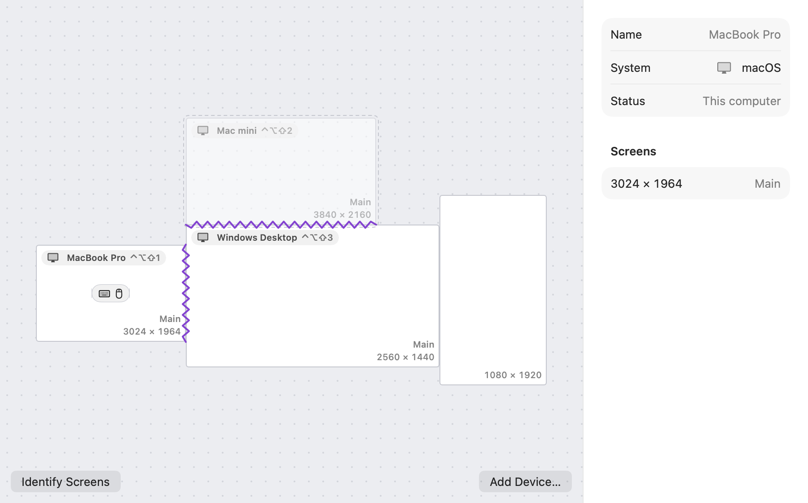
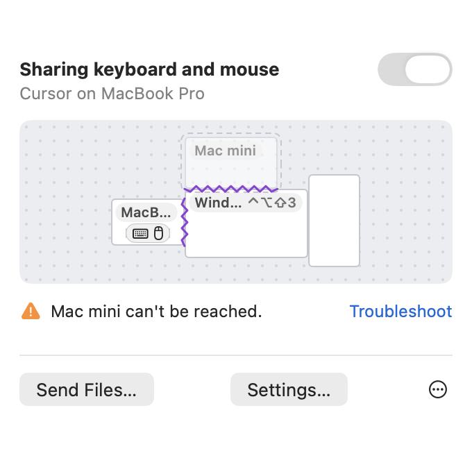
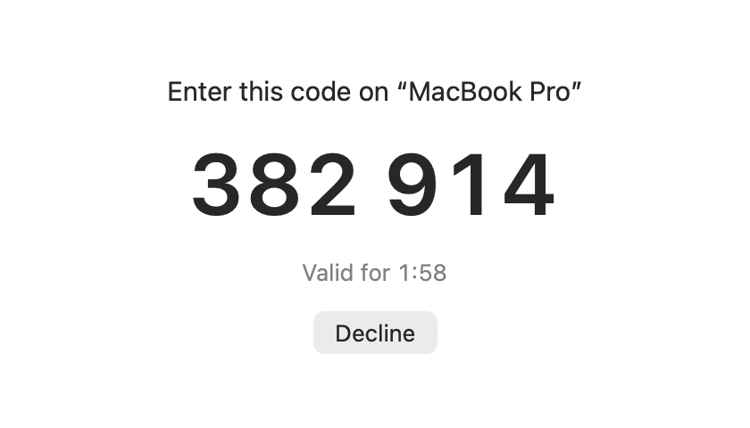

[English](README.md) · **繁體中文**

<picture>
  <source media="(prefers-color-scheme: dark)" srcset="docs/brand/logo-dark.svg">
  
</picture>

**一組鍵盤滑鼠，控制桌上的每一台電腦。** 游標移出一台的螢幕邊緣，就帶著鍵盤到旁邊那台繼續工作。在一台複製、到另一台貼上，也能互傳檔案。Mac、Windows 與 Linux 之間都可以，只走你的區域網路。

網站：<https://inputweave.ctsite.cc/zh-Hant/>

<a href="https://alternativeto.net/software/inputweave/about/?utm_source=badge&amp;utm_medium=referral"></a>

本文是英文 [README](README.md) 的翻譯；兩者不同時以英文版為準。

## 為什麼選 InputWeave

- **不用帳號、不經雲端、只走區網**：電腦在區網內互相找到、直接連線，打的字、剪貼簿和檔案都不經過任何伺服器。
- **加密，用配對碼配對**：每條連線都以 QUIC 上的雙向 TLS 加密，並釘選每台電腦自己的憑證。新電腦用螢幕上顯示的 6 位數配對碼加入，不必比對 fingerprint，也不必編輯設定檔。
- **內建剪貼簿同步與傳送檔案**：在一台複製，游標移到哪台就在哪台貼上：純文字、格式化文字、圖片，以及在 Finder 或檔案總管複製的檔案。Mac 與 PC 之間可以把檔案拖過螢幕邊緣，也可以放到 App 裡的電腦上傳送。
- **Windows 的登入畫面與 UAC 提示**也能從其他電腦操作，由 InputWeave 的系統服務負責。
- **原生 App**：macOS 是 SwiftUI 選單列 App，Windows 是 WinUI 3 系統匣 App，Linux 是 GTK 4／libadwaita App。
- **免費開源**：採用 GNU GPL 第 3 版或更新的版本。

## 畫面

<picture>
  <source media="(prefers-color-scheme: dark)" srcset="docs/screenshots/arrangement-dark.png">
  
</picture>

<picture>
  <source media="(prefers-color-scheme: dark)" srcset="docs/screenshots/panel-dark.png">
  
</picture>


macOS App 的排列頁、選單列面板，以及新電腦顯示的配對碼。畫面是英文介面，App 也有繁體中文；圖片由 App 的離屏快照產生（見 [`docs/screenshots`](docs/screenshots/README.md)）。

## 運作方式

每台電腦都執行一個小小的背景服務，App 透過它運作。在排列頁把每台電腦拖到它在桌上的位置，兩塊螢幕相接的地方會出現縫線，游標就從那裡穿過去。把游標推過縫線，它就到另一台繼續移動，鍵盤也跟著過去。你正在使用鍵鼠的那台負責帶路：它掌握整個排列裡唯一的游標，告訴游標下面的那台要把游標放在哪裡。

隨時按 ⌃⌥⇧⎋（Windows 與 Linux 是 Ctrl + Alt + Shift + Esc）把鍵鼠收回這台；連線中斷時鍵鼠也會自己回來。⌃⌥⇧L 把游標鎖在目前的電腦，⌃⌥⇧1 到 ⌃⌥⇧9 直接跳到某台，⌃⌥⇧G 切換成遊戲用的相對滑鼠，這些快速鍵都能在 App 的設定裡修改。架構說明在 [`docs/architecture.md`](docs/architecture.md)（英文），完整的用法見[使用指南](docs/user-guide.zh-TW.md)。

## 系統需求

| | 需求 |
|---|---|
| macOS | macOS 15 以上，Apple 晶片或 Intel |
| Windows | Windows 10 22H2 或 Windows 11，x64 |
| Linux | Ubuntu 24.04 以上，或 Debian 13，amd64 或 arm64；X11 或 Wayland（GNOME、KDE Plasma、sway、Hyprland、river） |

所有電腦都要在同一個區網，每台都要安裝 InputWeave。

## 安裝

從[最新版本](https://github.com/tasict/InputWeave/releases/latest)下載每台電腦的安裝檔。

- **macOS**：打開 `InputWeave-<版本>.pkg`，照步驟安裝。安裝檔以 Developer ID 簽章並經 Apple 公證。第一次打開會帶你完成設定，包括「輔助使用」與「輸入監控」權限。新版本在 App 裡安裝。
- **Windows**：執行 `InputWeave-<版本>-x64.msi`。它會安裝 InputWeave 服務與 App，並在防火牆上允許同一個區網的連線。安裝檔目前還沒有程式碼簽章，Windows 可能會請你確認。新版本在 App 裡安裝（設定 › 一般 › 更新）。
- **Linux**：依電腦的架構安裝套件：

  ```sh
  sudo apt install ./inputweave_<版本>_amd64.deb   # 或 _arm64.deb
  ```

  套件會加入 InputWeave 的套件來源，之後的版本會跟著系統的軟體更新一起送到（「軟體」、Discover 或 `apt upgrade`）。背景服務在下一次登入時啟動。

接著配對電腦：在其中一台打開「設定 › 裝置 › 新增裝置…」，選另一台，輸入它顯示的 6 位數配對碼。

## 授權

InputWeave 是自由軟體，沒有授權也能使用全部功能，沒有期限。加入授權之前，設定與「關於」會顯示「**試用中**」。授權是一次付款 US$10，會把它換成「**已授權**」的標籤，最多 5 台電腦使用；在一台輸入授權碼，和它配對的電腦會自動取得。其他都不變。授權由 [Polar](https://polar.sh/) 販售，詳情見[授權說明頁](https://inputweave.ctsite.cc/zh-Hant/license.html)。你也可以依 GPL 自己建置 InputWeave。

## 目前狀態

目前的版本已經在 macOS、Windows 與 Linux 上實際測試過。

- **Mac 的鎖定畫面與登入視窗**：要從其他電腦在那裡打字，需要虛擬鍵盤與滑鼠，這要有 Apple 核准給 App 的權限。核准還在等待中，所以 Mac 鎖定期間游標不會移過去。
- **Linux**：不能跨電腦拖曳檔案（請改用「傳送檔案」、把檔案放到 App 裡的電腦上，或在檔案管理員複製、到另一台貼上）。GNOME 的 Wayland 工作階段上沒有螢幕邊緣的光；每次登入後，要用這台的鍵鼠控制其他電腦前，桌面會先詢問一次。
- **Windows**：安裝檔還沒有程式碼簽章。

## 和其他方案比較

| | macOS、Windows 與 Linux | 開源 | 不用帳號 | 配對碼 | 剪貼簿 | 傳送檔案 | Windows 登入畫面／UAC |
|---|---|---|---|---|---|---|---|
| **InputWeave** | ✓ | ✓ GPL-3.0 | ✓ | ✓ 6 位數 | ✓ | ✓ | ✓ |
| Universal Control | ✗ 只限 Apple 裝置 | ✗ | – | – | ✓ | ✓ 拖放 | – |
| Mouse Without Borders | ✗ 只限 Windows | ✓ MIT | – | – | ✓ | ✓ | – |
| Synergy 3／ShareMouse | – | ✗ 商業授權 | – | – | ✓ | 依產品而異 | – |
| Deskflow／Barrier | – | ✓ GPL-2.0 | – | – | ✓ | ✗ | – |
| lan-mouse | – | ✓ GPL-3.0 | – | 信任憑證的 fingerprint | – | ✗ | – |

✓ 有 · ✗ 沒有 · – 不在這次比較的範圍，請看該專案自己的文件。

## 從原始碼建置

各平台的建置與測試見 [CONTRIBUTING.md](CONTRIBUTING.md)（英文）。簡單來說：

```sh
cargo build --workspace
cargo test --workspace

# macOS App（會建置並內嵌 Rust 的 agent）；需要 Xcode 26 與 XcodeGen
xcodegen generate --spec apps/macos/project.yml
xcodebuild -project apps/macos/InputWeave.xcodeproj -scheme InputWeave test
```

想在不碰真正鍵鼠的情況下試協定與路由，可以在任何平台以 `backend.kind = "mock"` 執行 agent，再用 `inputweave ctl` 操作。設定檔的格式寫在 `crates/inputweave/src/config.rs` 開頭。

## 參與與安全性

歡迎參與，請先讀 [CONTRIBUTING.md](CONTRIBUTING.md)（貢獻需要簽署[貢獻者授權協議](CLA.md)）。回報安全性問題請見 [SECURITY.md](SECURITY.md)。

## 授權條款

Copyright © 2026 InputWeave contributors。InputWeave 是自由軟體，以 [GNU 通用公共授權](LICENSE)第 3 版或（由你選擇）任何更新的版本釋出（`GPL-3.0-or-later`）。第三方元件的授權列在 [`THIRD_PARTY_NOTICES.md`](THIRD_PARTY_NOTICES.md)。
