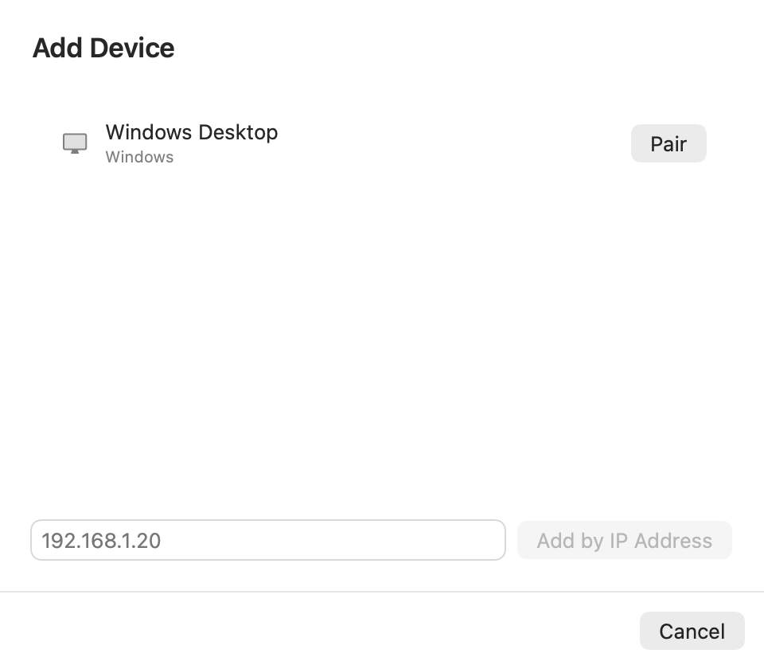
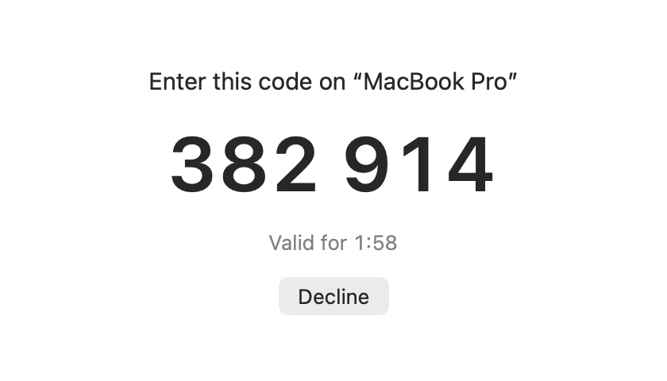
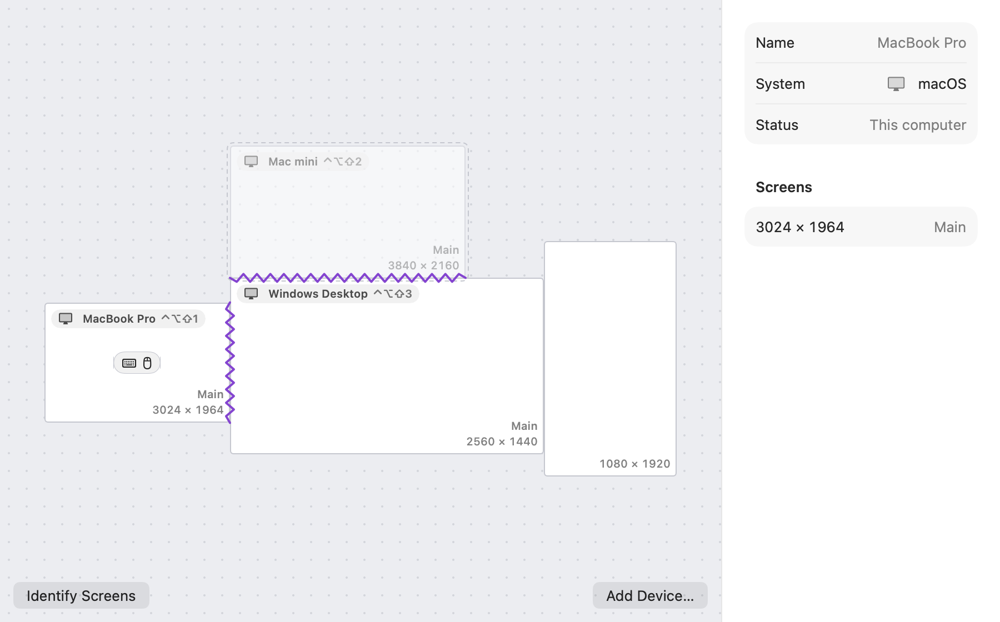
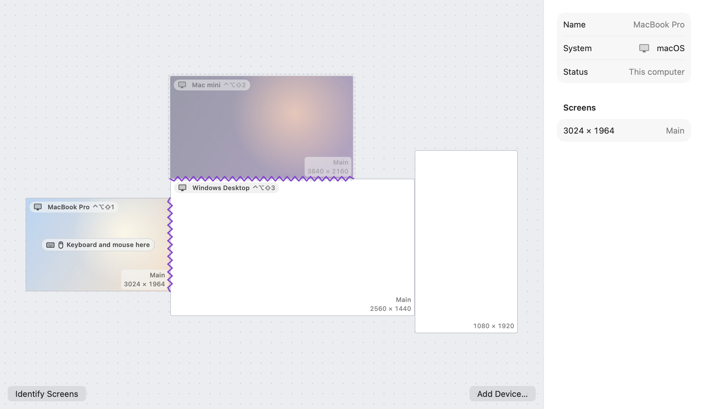
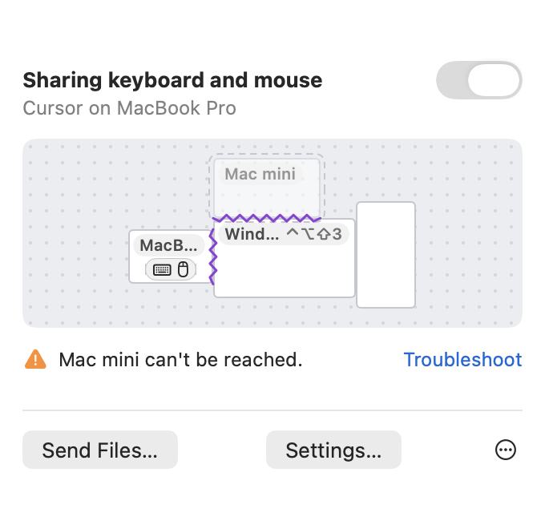
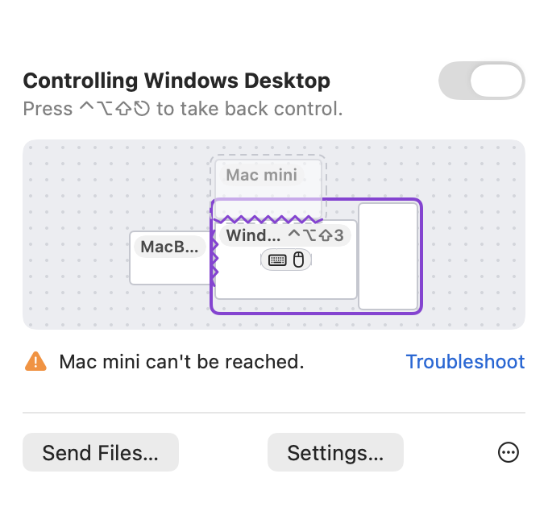
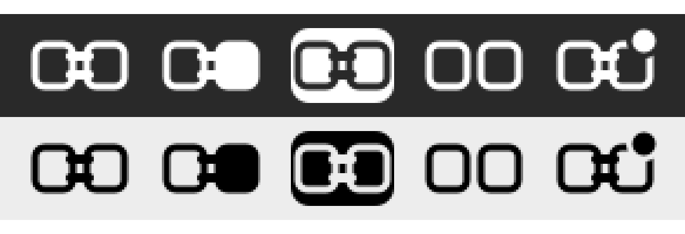
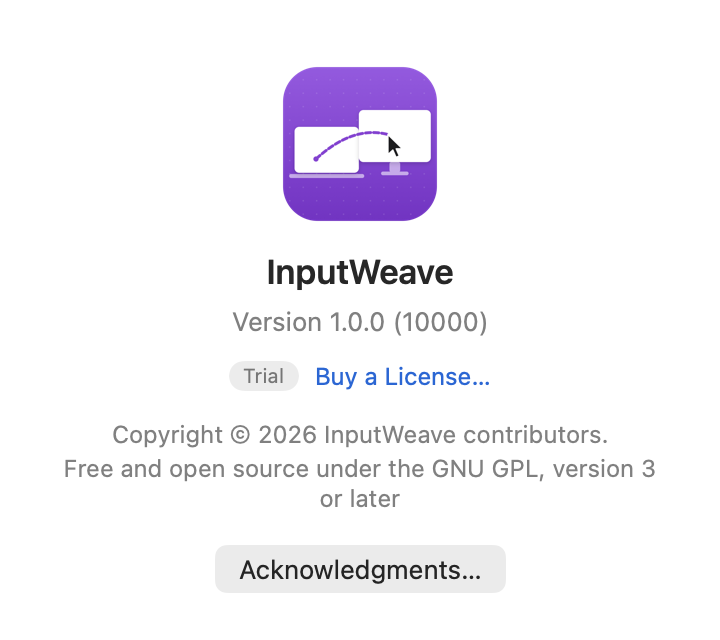

# InputWeave user guide

**English** · [繁體中文](user-guide.zh-TW.md)

InputWeave lets the computers on your desk share one keyboard and mouse. Move the pointer off the edge of a screen and it appears on the computer next to it; what you copy on one computer you can paste on another; drag a file onto another computer to send it there.

InputWeave runs on macOS 15 or later, Windows 10 22H2 or Windows 11 (x64), and Ubuntu 24.04 or later and Debian 13 (amd64 and arm64). Download it from the [latest release on GitHub](https://github.com/tasict/InputWeave/releases/latest). The screenshots here show the macOS app in English; every app is also available in Traditional Chinese.

## 1. Installing

### macOS (15 or later)

1. Open the installer, `InputWeave-<version>.pkg`, and follow its steps. InputWeave is installed in Applications and opens when the installer finishes. The installer is signed with a Developer ID and notarized by Apple.
2. The first launch opens "Set Up InputWeave"; follow the steps (section 2).

**Updates** come through InputWeave’s website, inputweave.ctsite.cc. When a new version is out, InputWeave offers it (Sparkle's update window); you can also choose Check for Updates… in the panel's ⋯ menu, or turn automatic checks off in Settings › General › Updates. Installing an update asks for an administrator's password, quits InputWeave, installs, and opens the new version; the new app restarts the background service on the new version by itself. Pairings and settings are kept. You can also install a newer `.pkg` by hand the same way. Don't drag the app into Applications over the old one: the installed app belongs to the system (root), and the app and the background service are running.

InputWeave lives in the menu bar. While Settings, setup or About is open, it also appears in the Dock and ⌘-Tab, so you can get back to a window another app covers; when they are all closed it is only in the menu bar.

### Windows (10 22H2 or later, 11)

Run `InputWeave-<version>-x64.msi`. It asks once for administrator permission (UAC). The installer is not code-signed yet, so Windows may also ask you to confirm. The installer:

- installs the InputWeave service, which starts with Windows and can also work on the sign-in screen and UAC prompts;
- installs the InputWeave app and adds InputWeave to the Start menu;
- allows InputWeave through the firewall for connections from **the same local network**;
- lets the service press Ctrl+Alt+Del for you (the "software secure attention sequence" policy).

When it finishes, InputWeave opens in the notification area at the right of the taskbar. Windows 11 puts new icons under "^" first; to keep it on the taskbar, open Settings › Personalization › Taskbar › Other system tray icons and turn InputWeave on, or drag the icon from "^" to the taskbar. To open the app again later, choose InputWeave in the Start menu.

**Updates** come through InputWeave’s website, inputweave.ctsite.cc. Settings › General › Updates checks once a day (Check for updates automatically, on by default) and has Check now. When a new version is out, a notification and a bar on the General page offer it; View update shows what's new, and Install downloads it, checks it against InputWeave's signature, and installs it after one UAC prompt. Sharing pauses for about a minute while it installs, then InputWeave opens again. If the download doesn't match the signature, nothing is installed. You can also run a newer `.msi` by hand. Pairings and settings are kept.

- **Left-click** the icon for the panel: the sharing switch, the arrangement of the computers (with their desktop pictures, and a keyboard and mouse on the one they are on; click a computer to move the pointer there), computers that can't be reached, files and the clipboard in progress, and Send Files… and Settings…. When the InputWeave service is stopped, Start Service in the panel starts it (UAC).
- **Right-click** for the menu: Pause Sharing (or Resume Sharing), Lock to This Computer (or Unlock, also Ctrl + Alt + Shift + L), Identify Screens, Add Device…, Settings…, Check for updates…, Quit InputWeave…. Quitting the app only removes the icon; the InputWeave service keeps sharing in the background. To stop sharing, use Pause Sharing.
- **Settings** has the pages General, Devices, Arrangement, File Transfers and Troubleshooting, plus License at the bottom of the navigation pane, and works as on macOS (sections 3 onwards). This computer's log folder can only be opened by administrators; Troubleshooting shows where it is, and Export Diagnostics… is all you need for a bug report.
- **When another computer pairs with this one**, the pairing code appears in the middle of the screen; type it on the other computer, nothing to do here. Choose Decline if you don't want to pair. If the InputWeave app isn't running, it is opened first.

**First-run setup (Windows):** the first time the app opens, "Set Up InputWeave" appears, up to 7 steps, with "Step n of N" at the bottom; every step but the first has Back:

1. **Welcome:** choose Start Setup.
2. **Name:** what other computers see; change it later in Settings › General.
3. **Network check:** only if the current network is set to Public, because other computers may not find this one. Choose Open Network Settings and set the network's profile to Private in Settings › Network & internet; the step checks itself off. You can also skip it.
4. **Connect another computer:** install and open InputWeave on another computer; it appears in the list, then choose Pair. If it doesn't appear, enter its IP address. Choose Later if you don't have another computer yet.
5. **Enter the pairing code:** type the 6 digits shown on the other computer (section 3), then Continue.
6. **Arrange:** drag that computer to where it sits on your desk.
7. **Try it:** move the pointer toward that computer; the step then shows the shortcut that takes control back. Choose Done.

To see it again, choose Run Setup Again… in the tray menu or the panel's ⋯ menu.

**Send to:** the first time InputWeave runs, it adds itself to File Explorer's Send to menu (section 7).

### Linux (Ubuntu 24.04 or later, Debian 13)

Download `inputweave_<version>_amd64.deb` (most PCs) or `inputweave_<version>_arm64.deb` (ARM computers, such as a virtual machine on an Apple silicon Mac) and install it in a terminal:

```sh
sudo apt install ./inputweave_<version>_amd64.deb
```

apt also installs the GTK 4 and libadwaita it needs. The package:

- installs the background service `/usr/bin/inputweave` and the app `/usr/bin/inputweave-app`, and adds InputWeave to the applications menu;
- adds InputWeave's package source, `/etc/apt/sources.list.d/inputweave.sources`, with its signing key: InputWeave's packages, through inputweave.ctsite.cc, signed with InputWeave's key;
- enables the background service for every user: it is the user's own systemd service `app-cc.ctsite.inputweave@agent.service` and starts with the desktop **at the next sign-in**, and stops at sign-out. GNOME and KDE Plasma start it themselves; on desktops that don't start `graphical-session.target` (Cinnamon, Xfce, MATE) an autostart entry starts it at each sign-in, so that it uses that session's display (those desktops don't stop it at sign-out). To start it without signing out, run `systemctl --user start app-cc.ctsite.inputweave@agent.service`.

**Updates** come with your system's software updates (Software, Discover or `sudo apt update && sudo apt upgrade`), from the package source the package added. A running background service switches to the new version at the next sign-in (or after `systemctl --user restart app-cc.ctsite.inputweave@agent.service`); when the app is open, or next opens, and finds the service on the old version, it restarts it. Pairings and settings are kept.

Open InputWeave from the applications menu; the first time, it starts first-run setup. The app's icon is in the panel's status area (KDE Plasma; Ubuntu's GNOME has the AppIndicator extension built in; on Debian's GNOME install and enable `gnome-shell-extension-appindicator`, or the app opens its window instead). Closing the window leaves the app in the status area; whether the app is open or not, the background service shares in the background. Settings › General › Open InputWeave at Login decides whether the icon appears at sign-in (off by default, as on macOS and Windows); things you need to decide (a pairing code, files received with Ask Each Time) open the app by themselves.

**Firewall:** installing doesn't change the firewall. Ubuntu doesn't turn ufw on by default; if you turned it on, other computers can't connect to this one until you run `sudo ufw allow InputWeave` once (UDP 47820 and mDNS's 5353; if the configuration file changes `[network] listen`'s port, also `sudo ufw allow <port>/udp`). With firewalld, run `sudo firewall-cmd --reload` after installing so it reads InputWeave's definition, then `sudo firewall-cmd --add-service=inputweave --permanent` and `sudo firewall-cmd --reload`. The `firewall:` line of `inputweave ctl status` says what it sees (ufw's rules are readable only by root, so usually it can only tell that ufw is on; when it can read them it says which port is blocked: 47820 blocked means others can't connect, 5353 blocked means they can't find this computer).

**Wayland and X11:** Ubuntu and Debian use Wayland by default. On Wayland, InputWeave controls this computer and reads its keyboard and mouse through the desktop's Remote Desktop and Input Capture features (portals), so the desktop asks you:

- **Let other computers control this one** (Remote Desktop or Remote Interaction): asked once, when setup or Settings › Troubleshooting requests it; choose Allow and it is remembered. If you stop sharing from the desktop's indicator, allow it again in the app.
- **Control other computers with this one's keyboard and mouse** (Input Capture): GNOME asks every time the background service starts (usually each sign-in); this is a current limit of the desktop.

An X11 session (such as "Ubuntu on Xorg" on the sign-in screen) asks none of this.

**Limits on Linux:**

- On Wayland, InputWeave only receives this computer's keyboard and mouse after the pointer touches an edge that leads to another computer. So while this computer isn't controlling another, the lock and jump shortcuts and shaking the mouse to find the pointer do nothing (pressing a jump shortcut while pushing against such an edge works); and while another computer controls this one, moving this computer's own mouse doesn't take control back: press the take-back shortcut on the controlling computer, or choose Pause Sharing in this computer's tray menu (while paused, other computers can't control this one).
- On Wayland you can't jump straight to another computer: Move Pointer Here on the Arrangement page is disabled, names don't show jump shortcuts, and the app says why. Jumping back to this computer works.
- On Wayland, when the pointer is pushed against an edge that leads to another computer, the desktop hands the keyboard and mouse to InputWeave first: with a dwell time or "hold a modifier to switch", while the pointer hasn't crossed, buttons and keys pressed then don't reach this computer's apps (they do again once the pointer leaves the edge).
- On Wayland, dragging with a button held (for example a window) into an edge that leads to another computer may cross: InputWeave only gets the keyboard and mouse there and doesn't know the button is down.
- On Wayland, while controlling another computer, the scroll direction is turned back into the way the wheel actually turned, following this computer's natural scrolling setting: the mouse's for wheels, the touchpad's for touchpads (GNOME and KDE; other desktops aren't corrected). With different settings for mouse and touchpad and a mouse that scrolls smoothly, the direction may be wrong.
- Dragging files across computers doesn't work on Linux. Use Send Files…, drop the files on a computer on the arrangement canvas, or copy them in the file manager and paste on the other computer.
- The notices at the top of the screen are on-screen notices on X11 and KDE Plasma, and system notifications on GNOME's Wayland. Identify Screens on Wayland opens a full-screen window on each screen that closes after a few seconds. The pointer locator (the pointer grows when you shake the mouse) is X11 only; GNOME has its own Locate Pointer (Settings › Accessibility).
- On X11 every screen counts as 100% scale; sizes on the arrangement canvas are in pixels.
- The sign-in screen can't be used from another computer: the background service is a user service that starts after sign-in.
- On wlroots compositors such as sway, Hyprland and river, InputWeave uses their own virtual keyboard and pointer and transparent surfaces at the screen edges instead of portals, so there is nothing to allow. When the pointer is pushed into an edge that leads to another computer, the keyboard is briefly InputWeave's (the focused window loses it and gets it back if the pointer doesn't cross). On those edges the outermost row of pixels belongs to InputWeave: clicks, scrolls and moves there don't reach the app underneath (for example a waybar or a scroll bar on that edge), also after a push that didn't cross; other edges aren't affected. While a button is held in an app (dragging), the pointer can't cross there; release first, then push. These desktops give virtual input to any program and have no permission dialog, so enabling InputWeave on them is the consent to be controlled by other computers; GNOME and KDE always ask. While the screen is locked, other computers stay out only if the system (logind) knows it's locked; swaylock doesn't tell logind by default, so other computers may still enter and type into swaylock's password field. Not yet tried on a real sway or Hyprland.

## 2. First-run setup (macOS)

Setup has 8 steps, with "Step n of 8" at the bottom. Every step but the first has Back; things already done (allowing it to run in the background, the name) aren't done again.

1. **Welcome:** you need another computer on the same network; setup takes about 5 minutes. Choose Start Setup.
2. **Run in the background:** choose Allow in Background. If macOS asks you to approve it, turn InputWeave on in System Settings › General › Login Items & Extensions, then come back.
3. **Permissions:** turn on "InputWeave Agent" in System Settings › Privacy & Security. Setup says which list to use for your macOS version:
   - macOS 27 or later: the "Device control and data access" list. Turning it on also checks Input Monitoring; nothing else to do.
   - macOS 15 and 26: both the Accessibility and the Input Monitoring lists.

   When the background service starts, macOS shows a prompt; Open System Settings there goes to the list, as does Open System Settings in setup. Setup checks every second, ticks the step when it's on, and restarts the background service once.
   - Accessibility: lets this computer's keyboard and mouse control others, and others control this one.
   - Input Monitoring: detects when the pointer touches the edge of the screen.
4. **Files and folders:** sending files you drag or choose, and saving received files to Downloads › InputWeave or where you drop them, uses the Downloads, Desktop and Documents folders, and macOS asks once for each; notifications need asking too. Choose Allow Access and macOS asks for the three folders one at a time (choose Allow for each), then for notifications, so the first transfer or drag isn't interrupted. You can also choose Later; macOS then asks the first time each is needed.
   - A folder you chose Don't Allow for can be turned on later for "InputWeave" in System Settings › Privacy & Security › Files and Folders.
   - Network volumes and external disks can't be asked about ahead of time: macOS asks the first time you send from there or drop files there.
5. **Name:** what other computers see; change it later in Settings › General.
6. **Connect another computer:** install and open InputWeave on another computer; it appears in the list. Choose Pair (section 3). If it doesn't appear, choose Add by IP Address. macOS may ask whether InputWeave may find devices on the local network: choose Allow, or it can't find other computers. Choose Later if you don't have another computer yet.
7. **Arrange:** drag the new computer to where it sits on your desk.
8. **Try it:** move the pointer toward that computer.

## 3. Pairing

Only paired computers can control each other. To pair:

1. On the computer with the keyboard and mouse, open Settings › Devices › Add Device… and choose Pair next to the other computer.
2. The other computer shows a 6-digit pairing code in the middle of its screen, valid for 2 minutes. Nothing to do there; if you didn't start this, choose Decline. If its app isn't running, the background service opens it first.
3. Type the code on the first computer. A wrong code can be tried again; after 3 wrong tries, start over. After any wrong try, a new pairing can't start for 30 seconds after that one ends.

 

Left: choosing the computer to pair, on the one with the keyboard and mouse. Right: the pairing code on the other computer.

Once paired, the two remember each other and connect by themselves from then on. To remove a device, select it in Settings › Devices and choose Remove Device….

## 4. Arrangement

Settings › Arrangement shows each computer and its screens, to scale.

<picture>
  <source media="(prefers-color-scheme: dark)" srcset="screenshots/arrangement-dark.png">
  
</picture>

- Drag a whole computer to where it sits on your desk. Near another computer it snaps, and a seam appears along the edges that meet: that is where the pointer crosses. It doesn't have to line up exactly: from an edge without a seam, as long as there is another computer on that side, the pointer goes to the closest point of that computer, skipping the gap.
- The screens within one computer are placed as that computer's own display settings place them.
- A computer dropped where its screens would overlap another's springs back.
- The arrow keys nudge the selected computer.
- The arrangement is synced to every connected computer.
- Right-click a computer and choose Move Pointer Here to put the pointer in the middle of its main screen without pushing it across.
- **Identify Screens:** when you can't tell which screen on the canvas is which on your desk, choose Identify Screens at the bottom left of the Arrangement page (also in the panel's ⋯ menu). This computer and every connected one show their name in large type in the middle of each of their screens, with "Screen 1 · 3024 × 1964" below (the screen's number in that computer's order, then its pixels), and a purple frame around each screen, fading after about 2.5 seconds (or disappearing at once with Reduce Motion). At most once a second. Windows works the same (Identify Screens at the bottom left of the Arrangement page and in the tray and panel menus; the cards also show the jump shortcut, such as Ctrl + Alt + Shift + 1; with Settings › Accessibility › Visual effects › Animation effects off they disappear at once); the Windows app must be running.
- **Naming other computers:** select another computer and type a new name in the Name field at the top right, then press Return (Enter on Windows) or click elsewhere (or right-click the computer and choose Rename…). The name is used only on this computer: the arrangement, the panel, notifications, the transfer history and `inputweave ctl` use it, but that computer and the others don't know it and keep using the name it gave itself. Under a changed name, the field says "This computer calls itself "…""; clearing the field goes back to that name. This computer's own name is changed in Settings › General and synced to the others.
- When a computer is selected, the right side shows its state, such as "Connected · 3 ms": 3 ms is the time for a round trip between the two (latency), updated every few seconds; until it is measured, just "Connected". Settings › Devices shows it too.
- The keyboard and mouse badge, "Keyboard and mouse here", marks the computer the shared keyboard and mouse are on, on its main screen; on a narrow screen only the icons show.

**Desktop pictures:** the Arrangement page and the panel's map show each computer's desktop picture behind its screens, so you can tell them apart at a glance. A light layer of the screen color covers the picture so names, seams and resolutions stay readable. Each computer sends a small thumbnail of its desktop picture (at most 320 pixels on its long side) to the paired computers it is connected to, and an updated one within about a minute of a change. The thumbnails are only sent between your computers; the other computers' thumbnails are kept in this computer's settings folder, so they show while those computers are offline (faded with them), and are deleted when you unpair.

To stop sharing yours, turn off "Share this computer's desktop picture with paired computers" in Settings › General › Desktop Picture; the other computers drop its thumbnail at once and show a plain screen. A computer's screens also stay plain when:

- that computer turned sharing off;
- its desktop picture is a solid color;
- it is a Windows computer on the sign-in screen: the desktop picture can only be read once someone signs in, so nothing is sent before (and it's cleared after signing out);
- it is a Mac whose display was connected while the background service was running: the thumbnail may need the service restarted (for example by signing out and in);
- it is a Linux computer whose desktop is neither GNOME nor KDE Plasma, unless it's an X11 desktop that puts its picture on the root window for other programs (as feh and nitrogen do); on such a desktop each screen shows the part of the picture under it;
- it hasn't connected since pairing.

<picture>
  <source media="(prefers-color-scheme: dark)" srcset="screenshots/arrangement-pictures-dark.png">
  
</picture>

## 5. Everyday use

- **Switching:** when the pointer touches a seam it moves to the other computer, and the keyboard follows. At an edge without a seam, if there is another computer on that side, the pointer goes to the closest point on the nearest screen on that side and keeps moving (if that is another screen of the same computer, the pointer stays where it is, as the system does); a short stretch near the corners of the screen doesn't switch, so hot corners keep working.
- **Take back control:** press ⌃⌥⇧⎋ (Control-Option-Shift-Esc) and the keyboard and mouse come straight back to this computer, the one with the physical keyboard and mouse. This shortcut is never passed to other computers.
- **Jump to a computer:** click a computer on the panel's map to put the pointer in the middle of its main screen; click this one to come back. Nothing happens while sharing is paused or the pointer is locked; a computer that isn't connected wiggles.
- **Jump with a shortcut:** ⌃⌥⇧ with a digit 1 to 9 puts the pointer in the middle of that computer's main screen. The computers in the arrangement (this one included, offline ones too) are numbered left to right by their position on the Arrangement page, top to bottom where their left edges line up; each computer's shortcut is shown beside its name on the Arrangement page and the map, and in the Devices list. Nothing happens if that computer isn't connected, or while sharing is paused or the pointer locked. These keys aren't passed to other computers.
- **Lock to the current computer:** for games or precise work, press ⌃⌥⇧L (Control-Option-Shift-L): the pointer stays on the computer it is on (this one or the one being controlled) even at its edges; press again to unlock. Not passed to other computers. Lock to This Computer and Unlock are also in the panel's ⋯ menu. While locked, the panel's title says "Locked to" and that computer's name, and a notice appears at the top of the screen. ⌃⌥⇧⎋ still brings the keyboard and mouse back while locked, but the lock stays, keeping the pointer on this computer. Pausing sharing doesn't unlock; quitting InputWeave or restarting the background service does. On macOS, ⌃⌥⇧L isn't passed to this computer's apps; on Windows, while not controlling another computer, these keys still reach this computer's apps.
- **Relative mouse for games:** many games (especially first-person ones) hide the pointer, lock it to the window and read only how far the mouse moved. To play such a game on another computer, press ⌃⌥⇧G (Ctrl + Alt + Shift + G on Windows) to switch to relative mouse: the mouse's movements go to that computer as they are and the pointer doesn't cross to other computers, so the game can turn its view; press again to go back. It also ends when you press ⌃⌥⇧⎋, jump to another computer, or that computer disconnects or locks. These keys aren't passed to other computers; while the pointer is on this computer they are ordinary keys for its apps. When the controlled computer is a Windows PC and a game hides the pointer and locks it to its window, InputWeave switches to relative mouse by itself and back when the game lets the pointer go (for example in a menu; up to a second later); to stop that, turn off "Switch to relative mouse when a game holds the pointer" in Settings › General › Switching (or `inputweave ctl relative --auto off`). Ending it with ⌃⌥⇧G after an automatic switch keeps your choice until the game next holds or releases the pointer. A Mac can't reliably tell whether a game holds the pointer, so on a controlled Mac switch by hand. After relative mouse ends, the pointer carries on from where that computer's pointer was. Games that only hide the pointer without locking it aren't switched automatically; switch by hand. Both computers need a version with this feature; with an older one, ⌃⌥⇧G doesn't switch but is passed on as an ordinary key, and a notice says that computer's version doesn't support relative mouse. While it's on, a notice says "Relative mouse: the pointer is locked to "Windows Desktop". Press ⌃⌥⇧G to end it.", and the panel's title says "Relative mouse:" and the computer's name; notices also appear when it ends, including when a game lets go; the notice for an automatic switch appears at most once a minute per computer after the first, so a game opening its menu doesn't keep showing it. The menu bar and tray icons are the same as when controlling another computer. Change the shortcut under Toggle Relative Mouse (Games) in Settings › General › Shortcuts; its switch turns the shortcut off (then only the automatic switch or the command line). From the command line: `inputweave ctl relative on`/`off` (section 9) and `inputweave ctl hotkeys set --relative …` (`--relative ""` turns it off). When updating from an earlier version on a computer that already has a shortcut on ⌃⌥⇧G, that one stays and relative mouse starts with its shortcut off; set one when you want it.
- **Wait before switching:** if the pointer slips across by accident, turn on "Wait before switching" in Settings › General › Switching: the pointer has to push against the edge for a moment (150 milliseconds) before it switches. A quick push doesn't switch, and moving away from the edge starts over. For another duration use `inputweave ctl dwell` (section 9); a value set with it is kept when you turn the option off and on again while the app runs.
- **The edge lights up when you cross:** when the pointer crosses to another computer, the edge it crossed lights up briefly in purple on both the screen it left and the one it entered (under a second, brightest where it crossed), so you can see where it went. Jumps with a shortcut or the map don't light up. To turn it off, turn off "Light up the screen edge when the pointer crosses to another computer" in Settings › General › Switching; it's set on each computer. With Reduce Motion (on Windows, Animation effects off) the light appears and disappears without fading; on Windows it doesn't show during full-screen games or presentations. On Linux it shows on X11 and KDE Plasma (on X11 without a compositor as a thin solid line without fading); on GNOME's Wayland session apps can't draw on the screen, so there is no glow.
- **Hold a modifier to switch:** under "Switch to another computer" in Settings › General › Switching, choose "While holding ⇧" (or ⌃, ⌥, ⌘): the pointer crosses a seam only while you hold that key, in both directions; otherwise it stops at the edge. Jumping with a shortcut or the map isn't affected. The key held to cross isn't pressed on the other computer. Also `inputweave ctl edge --modifier shift` (`none` for no key).
- **Changing shortcuts:** Settings › General › Shortcuts lists four: take back control, lock to the current computer, jump to computer N, and toggle relative mouse (games) (the last is missing when the background service is an older one without relative mouse). Choose Record and press the new combination (at least one modifier); Esc alone cancels, Delete alone restores that shortcut's default. For jumping, press the modifiers with any digit; its switch turns the whole set off, and relative mouse has a switch too. No two can be the same, and the jump modifiers with a digit can't match the others. Reset Shortcuts restores all the defaults. While recording, the current shortcuts still work (for example the current lock combination toggles the lock), so a combination in use can't be recorded. Each computer has its own shortcuts; when controlling another computer, the ones of the computer in front of you apply. Also `inputweave ctl hotkeys` (section 9).
- **Finding the pointer:** if you lose the pointer, shake the mouse quickly from side to side: the pointer on the computer it is on grows to 4 times its size, pauses, and shrinks back (about a second), following the mouse as it grows; the keyboard and mouse badge on the panel's map bounces too. With Reduce Motion (on Windows, Settings › Accessibility › Visual effects › Animation effects off) the pointer shows 3 times its size for a second. On a Mac the enlarged shape is always the arrow. The Windows app must be running for this.
- **Coming back by itself:** if the other computer disconnects, or someone uses that computer's own mouse, the keyboard and mouse come back here, and a notice at the top of the screen says why.
- **⌘ and Ctrl:** when controlling Windows, select that computer in Settings › Arrangement and turn on "Swap ⌘ and Ctrl" to use ⌘C and ⌘V as usual.
- **Typing passwords:** while macOS's Secure Keyboard Entry is on (for example in a password field), keystrokes stay on this computer.
- **The Mac lock screen and login window:** they only accept input that looks like a physical keyboard and mouse, so InputWeave needs a virtual keyboard and mouse there, which needs a permission Apple grants. Settings › General › Lock Screen says whether this Mac can; if not, the pointer doesn't move onto it while it's locked, and other computers show it as "Screen locked, no input". When it can, you can also turn on "Let other computers control this Mac at the login window" (or `inputweave ctl login-window on`): from the next time the login window appears (for example after logging out), other computers can choose a user and type a password there. It uses the last user's pairings and arrangement, so that user must turn it on, and InputWeave must have been installed with the installer; while that user is still logged in (back at the login window with fast user switching), the login window can't be used from other computers. The login window can't pair new computers or receive files or the clipboard; other computers keep showing this computer's last desktop picture. With FileVault on, a Mac that restarts asks for a password before macOS starts, and that screen can't be used from another computer.
- **Windows shortcuts** are shown as text: take back control is Ctrl + Alt + Shift + Esc, lock is Ctrl + Alt + Shift + L, jump to computer N is Ctrl + Alt + Shift + digit (written Ctrl+Alt+Shift+2 beside the names on the Arrangement page, the map and the Devices list). Changing shortcuts and "Switch to another computer" (while holding Ctrl, Alt, Shift or the Windows key) are in Settings › General and work as above: choose Record and press the new combination; Esc alone cancels, Delete or Backspace alone restores the default, and if the background service refuses one, red text under the card says why. Combinations Windows keeps for itself (such as Win + L, Win + digit) can't be recorded. When the keyboard and mouse come back by themselves, the lock goes on or off, relative mouse starts or ends, and the first three times you control another computer, a notice appears at the top of the screen on Windows too, fading after about 2.5 seconds and staying while the mouse is over it; it never takes focus or blocks clicks.

The panel's map shows each computer's name, and the small keyboard and mouse icons mark the computer the shared keyboard and mouse are on (on this one while another computer controls it); the screens show each computer's desktop picture (section 4); faded, dashed computers can't be reached right now. Click a computer to jump there, drop files on it to send them. While controlling another computer, the panel's title names it, and its outline turns purple.

<picture>
  <source media="(prefers-color-scheme: dark)" srcset="screenshots/panel-dark.png">
  
</picture>


The menu bar icon shows the current state. Below, the top row is on a dark menu bar and the bottom row on a light one; from left to right: normal, controlling another computer (the right screen is filled), controlled by another computer (the whole icon inverted), paused (no seam), and needs attention (a dot at the top right; section 8).



The panel's switch pauses sharing. While paused, this computer doesn't control others and others can't control it; if another computer is controlling this one, the keyboard and mouse come back at once. Resuming starts again. Quit InputWeave (panel ⋯ › Quit InputWeave) stops sharing until the next login or until you open the app again. Choose Only Hide the Menu Bar Icon in the same dialog to keep sharing without the icon; open InputWeave from Applications to bring it back. Settings › General › Show in Menu Bar also hides or shows the icon.

About InputWeave (panel ⋯ menu) shows the version, the copyright, the license (InputWeave is free software under the GNU GPL, version 3 or later) and whether this computer has a license (section 12); Acknowledgments… lists the third-party components in InputWeave and their licenses.

<picture>
  <source media="(prefers-color-scheme: dark)" srcset="screenshots/about-dark.png">
  
</picture>

## 6. Clipboard

Nothing to do: copy on one computer, move the pointer to another and paste. Plain text, formatted text (RTF, HTML) and images are supported.

- The clipboard is synced only when the computer the pointer leaves has something newly copied, so computers don't overwrite each other back and forth.
- Content your password manager marks as secret isn't synced. Content over 8 MB and up to 256 MB (for example a large image) isn't sent when the pointer moves over, but when you paste on the other computer, so pasting may take a few seconds; if you copy something else on the first computer meanwhile, the paste comes out empty. Anything larger isn't synced; use Send Files. With Windows computers, large content is limited to 64 MB. While a Windows PC pastes large content from another computer, other apps can't use the clipboard for up to 30 seconds; if it doesn't arrive in 30 seconds nothing is pasted, and you can paste again. Both computers need this version or later; older ones only take content up to 8 MB. If your clipboard manager reads every new item, large content is sent as soon as the pointer moves over.
- The panel shows the last sync, or why there wasn't one.
- Files and folders copied in Finder or Windows File Explorer can be pasted in Finder or File Explorer on another computer: when the pointer moves over, only the list of files is passed on; when you press ⌘V (Ctrl+V on Windows) they are sent from the first computer, into a temporary folder on the receiving one (`~/Library/Caches/InputWeave/Clipboard` on a Mac, `%LOCALAPPDATA%\InputWeave\clipboard` on Windows), and Finder or File Explorer copies them to where you pasted, so twice the space is needed; Finder waits until they're there, and File Explorer shows its copy progress. On a Mac, if it takes long (over about 100 seconds), that paste gives nothing; press ⌘V again once the files have arrived. It gives up only after 2 minutes with no progress. On Windows, the InputWeave app puts these files on the clipboard: if it isn't running, moving the pointer over opens it in the background (only the tray icon); it must be running for these files to paste. After you quit the app with Quit InputWeave…, InputWeave doesn't open it for files on the clipboard until you open it yourself (even after a restart); only the names arrive as text then (another computer asking to pair still opens it to show the code). These files don't stay in clipboard managers, Windows clipboard history or the cloud clipboard. If you copy something else on Windows while files are still arriving, the paste in progress completes. Images copied with the files don't reach Windows; text (including HTML and RTF) does, unless those other contents total more than 1 MB. Both computers need this version or later; older ones only receive the names as text. The two computers must be connected directly (paired), with "Send and receive files with this computer" on; unreadable files in a folder are skipped and the rest sent; files or folders whose names would be changed on the other computer (containing `\`, with spaces at either end, or longer than 255 bytes, such as 86 or more Chinese characters) don't appear on its clipboard, the others do. If this computer is already sending other files to that one, the pasted files queue behind them, and Finder waits. Files received this way are listed in File Transfers without a "Received" notification; the temporary copy is deleted 10 minutes after you copy something else. The clipboard marks this content as transient, so clipboard managers that follow the nspasteboard.org conventions (such as Maccy) don't record it; programs that read every item start the transfer as soon as the pointer moves over. Files you cut on Windows are only copied; the files on the PC aren't deleted. Files on network drives and shared folders can be sent as long as you can read them on the PC. If a shared folder is slow or unreachable, copied text still arrives within a few seconds, and whether the files can be sent is only known when you paste.
- Settings › General › Clipboard turns syncing off.
- To stop syncing with one computer only, select it in Settings › Devices (or the Arrangement page) and turn off "Sync clipboard with this computer": this computer doesn't give it the clipboard or take its clipboard, and doesn't pass it on when the pointer crosses this computer between it and others. Only this computer stops; that computer isn't told and its settings don't change.

On Windows:

- The clipboard is read and written by an InputWeave helper running as you, so it is only synced while someone is signed in; on the sign-in screen, this computer's clipboard is neither sent nor received.
- Content copied on Windows that is marked not to be monitored (`ExcludeClipboardContentFromMonitorProcessing`), or not allowed in clipboard history or the cloud clipboard (`CanIncludeInClipboardHistory`, `CanUploadToCloudClipboard` set to 0), counts as secret and isn't synced.
- Line breaks are converted to each platform's convention (CRLF on Windows). Images copied only as bitmaps are sent as PNG; images from other computers are put on the clipboard as both PNG and bitmap, so apps that only take bitmaps can paste them (transparent areas become white).

## 7. Sending files

- **Drag and drop:** drag files onto a computer on the Settings › Arrangement canvas. Computers that can receive them rise and say "Drop to send"; offline ones fade.
- **Choose files:** Send Files… in the panel, or Settings › File Transfers › Send Files…. Choose the computer at the bottom of the file dialog (on Windows, after choosing the files, it asks which computer if more than one is connected).
- **Windows Send to:** right-click files in File Explorer and choose Send to › InputWeave (on Windows 11, first Show more options). With one computer connected they are sent at once; with more, it asks which first, then opens the panel to show progress. To remove the entry, turn off "Show InputWeave in the Send to menu" in Settings › General; you can turn it on again later.

**Folders** can be sent too: drag a folder onto a computer on the canvas, choose one in the Mac's Send Files… dialog, or use `inputweave ctl send <device> <folder>`. Its contents arrive with the same structure, empty folders included; symbolic links aren't sent. If the other computer already has a folder with that name, the received folder is renamed as a whole, for example "Photos (1)", rather than mixed into it. At most 1,000 items, 10,000 files or 100 GB at a time; send more in batches.

**Not sending files with one computer:** select it in Settings › Devices (or the Arrangement page) and turn off "Send and receive files with this computer". It is then missing from Send Files…'s list, fades with "Sending files with "…" is turned off." when you drag onto it, and isn't a target when dragging across a seam; files it sends are refused, and it sees the same as "doesn't accept files". Only this computer stops; that computer isn't told. Transfers already running or queued aren't affected. On Windows, Send to › InputWeave doesn't send to it either.

If some of what you send can't be sent (unreadable files, links), only those fail; the rest are sent. In the panel and on the File Transfers page a folder is one row: under its name, how many files and how large (for example "312 files · 1.2 GB"); the progress bar covers the whole folder, and while sending it says "117 of 312 files". When some files in a folder didn't make it, the row says afterwards "45 received, 3 failed" ("sent" on the sending side), and Details lists which and why (up to 100, then "and N more"); such rows stay in the panel like failed ones until you dismiss them with ×, and dismissed rows don't come back when the app reopens. `inputweave ctl send` and `inputweave ctl transfers` list the failed files too (for example `failed: Photos/link (symlink)`, with "8 of 10 files sent, 2 failed" last). The Windows app's folder row also says "8 sent, 2 failed", and Show details lists the failed paths and why.

### Dragging files to another computer (Mac)

On a Mac you can drag files or folders from Finder across a seam and drop them where you want on another computer:

1. Start dragging files or folders in Finder (several at once is fine).
2. Drag them to the seam, the stretch of screen edge that meets the other computer, and keep pushing. At the seam InputWeave first takes stock of what to send; a very large folder may take a moment before it crosses.
3. The pointer carries the drag onto the other computer, and this computer shows "Dragging 3 items to "Windows PC"" at the top of the screen.
4. Release on the other computer. If it is a Mac, it shows "Drop the items where you want them", with the drag image following the pointer; drop into a Finder window or the desktop and the files go to that folder, and Finder shows them once they've arrived. Names that clash with existing ones are handled as Finder chooses (for example Keep Both). This computer shows "Sending to "Mac mini"…", and the panel shows progress as usual.

- Dropping where nothing can be dropped, pressing Esc, or dragging back to this computer and releasing sends nothing. If the other computer didn't take the drop, this computer shows ""Mac mini" didn't receive them".
- Drags only cross at seams, and not while sharing is paused or the pointer is locked to this computer.
- Only sources that have files while dragging, like Finder, work; for the Photos app, mail attachments and others that make the file only after the drop, save the file first, then drag it.
- The first time you drop on the desktop or a folder such as Documents, macOS may ask whether "InputWeave Agent" may access that folder; without it the files can't be saved.
- With this computer's mouse, you can also drag files on another computer this one controls, back to this computer or on to a third (both need this version or later). Dragging back here, this computer shows "Drop the items where you want them", and dropping into Finder brings them over. To a third computer, the drop only works if that computer and the one with the files are also paired and connected directly; otherwise the pointer still crosses but nothing is sent on release.

While sending, the panel's In Progress section shows progress, speed and time left; ⊗ cancels. If the connection drops it says "Waiting for connection…", and continues where it stopped once connected; nothing is sent twice. Failed or refused transfers stay in the panel with the reason until you dismiss them with × (the history stays in Settings › File Transfers). On Windows, dismissed rows, and those that failed or were refused before the app opened, don't show in the panel after the app reopens.

Many files at once are fine: two are sent to the same computer at a time, and the rest queue in the order you sent them, "Waiting to send…", starting when their turn comes; queued files can be cancelled with ⊗ too. If the other computer goes offline, the whole queue waits for it and continues in order. The keyboard and mouse always come first: when the network starts to slow down, InputWeave slows file transfers down, and speeds up again as the network recovers, so the pointer stays smooth during large transfers, which may take longer.

Received files are saved in Downloads › InputWeave, renamed when names clash, for example `Report (1).pdf`. When everything has arrived a notification says so, with Show in Finder. In Settings › File Transfers you can:

- change the folder;
- choose Ask Each Time: when files arrive, the notification and the panel show Accept and Decline. No answer within 5 minutes counts as Decline. Files and folders sent together are asked about once, and the answer covers them all.

On Windows the notification's button is Open Folder, and clicking the notification opens Settings › File Transfers; with Ask Each Time, the notification has Accept and Decline (the first time, Windows may ask whether InputWeave may show important notifications; allowing it shows them during Do not disturb too). Received files go to your Downloads › InputWeave (usually `C:\Users\<you>\Downloads\InputWeave`, following the Downloads folder if you moved it). They are written by an InputWeave helper running as you, so you own them, not the system. When no one is signed in (sign-in screen), Windows doesn't receive files, and the sender sees that the other computer doesn't accept files. Characters Windows doesn't allow in names (`< > : " / \ | ? *`) become `_`, and reserved names such as `CON` and `NUL` get a `_` in front. `inputweave ctl transfers` also lists received files and where they are.

When sending from Windows, files are read by the same helper running as you: files you can't open yourself (for example ones only administrators can read) can't be sent and are listed as failed, while the others go; sending only that one, `inputweave ctl send` shows "the agent refused the request (unreadable): cannot read …: Access is denied.". Files can't be sent from Windows when no one is signed in.

With Ask Each Time, the InputWeave app opens by itself when files arrive and it isn't running.

**Dragging to another computer (Windows):**

- From Windows: select files or folders in File Explorer, drag them toward the edge of the screen on the side of the other computer, and keep pushing past the edge without releasing; once the pointer carries the drag onto the other computer, release where you want them (a Finder window, the desktop). Near the edge (about 40 points) InputWeave starts preparing (a large folder must be listed first, which may take a second or two), and the pointer doesn't cross until it's ready; push a little longer. When it crosses, the notice says "Dragging 3 items to "Mac mini"", and sending starts once they're dropped, with progress in the panel. The original files are always copied, never moved or deleted. Releasing before crossing, or Esc, sends nothing. This also works while this computer is controlled by another: with that computer's mouse, drag files in this computer's File Explorer to a seam, and that computer carries the pointer over, to itself or a third computer (both need this version or later).
- To Windows: drag files from another computer across the edge onto Windows; the notice says "Drop the items where you want them"; drop them into a folder in File Explorer or on the desktop. The InputWeave app must be running on Windows. Windows doesn't tell InputWeave where you dropped them, so the files are first received into a temporary folder in `%LOCALAPPDATA%\InputWeave\drag`, and once all have arrived File Explorer copies them to where you dropped them (with its copy progress window); the temporary folder is then deleted. Large files are therefore written twice on Windows and need the space twice while arriving. Esc while dragging, moving back to the first computer, or releasing near the edge of the screen (the drag receiving area) sends nothing. Files received this way don't go to Downloads › InputWeave and don't notify; Settings › File Transfers lists them, without Show in File Explorer.

Settings › File Transfers › Recent keeps, besides transfers in progress, the last 100 that ended (sent, received, refused, failed, cancelled), also after the background service or the computer restarts; beyond 100, the oldest are removed. To remove one, choose × at the right of its row, or right-click it and choose Remove from History; Clear History… next to Recent removes all ended ones after confirming. This only clears the list: sent and received files stay where they are, and transfers in progress aren't affected. The history is in `transfers.toml`: on macOS next to the configuration file in `~/Library/Application Support/InputWeave`; on Windows in each user's own `%LOCALAPPDATA%\InputWeave`, so each account on a computer has its own history, listed once signed in and gone from the list after signing out, and transfers that end while no one is signed in leave no record. From the command line: `inputweave ctl transfers --remove <id>` and `--clear` (section 9).

## 8. Troubleshooting

Settings › Troubleshooting lists current problems and the state of the background service and permissions. On Linux it also lists Wayland's two permissions ("Other computers control this one", "This computer's keyboard and mouse control others") and their state, with Allow… (or Allow Again…) when not yet allowed, refused, or stopped from the desktop, which makes the desktop ask; a note that on GNOME the clipboard needs remote control allowed first; a notice when ufw blocks InputWeave, with `sudo ufw allow InputWeave` to copy; the desktop session (X11 or Wayland, which desktop) and what handles each part, with reasons when something doesn't work (in English, as in the diagnostics); and, since there is no log folder, the two commands to read the journal, to copy. On a Mac there is also Files and Folders: whether Downloads, Desktop and Documents are each allowed. For a folder that isn't, choose Open System Settings to turn it on for "InputWeave" in Privacy & Security › Files and Folders, then come back and choose Check Again. If it hasn't been asked yet, Allow Access makes macOS ask (as in setup's step 4).

While InputWeave is open, these two situations send a notification, because sharing has stopped and you may not be looking at the menu bar:

- "InputWeave's Accessibility permission was turned off, and sharing stopped." (or Input Monitoring): choose Open System Settings in the notification and turn "InputWeave Agent" back on in the list; the background service restarts by itself. On macOS 27 the list is "Device control and data access".
- "The background service is off, so sharing isn't working.": usually InputWeave was turned off in System Settings › General › Login Items & Extensions. Choose Open Login Items Settings and turn it back on; when the notification's button is Turn On, choosing it turns the background service back on.

On Windows there is one problem notification: "The InputWeave service stopped, so sharing isn't working." Start Service (UAC) starts it again. It appears only after the service has been stopped for more than 10 seconds; when the service ends unexpectedly, Windows restarts it within seconds and there's no notification. Restart Service on the Troubleshooting page doesn't notify either.

Clicking the notification opens the Troubleshooting page. Notifications are withdrawn once the problem is solved. They only appear when things go from working to not working: for a problem already there when InputWeave opens, see the dot on the menu bar icon and the panel; quitting InputWeave yourself doesn't notify. If you didn't allow InputWeave's notifications, turn them on in System Settings › Notifications › InputWeave.

| Symptom | What to do |
|---|---|
| A dot at the top right of the menu bar icon | Open the panel to see why: a permission was turned off, the background service was turned off, or the service hasn't answered for over 10 seconds. It doesn't appear in the first seconds after the app opens or the service restarts or updates |
| The pointer won't cross | Check that the other computer says Connected in Settings › Devices and sits on the side you push toward in Arrangement; don't push through the corners of the screen |
| The other computer can't be found | Both must be on the same local network, and the router must not isolate wireless clients (AP isolation). You can also add it by IP address |
| The background service doesn't answer | Restart Background Service on the Troubleshooting page |
| Still can't control after allowing the permissions | Turn InputWeave's permissions off and on again in System Settings, then restart the background service |
| "This computer's keyboard and mouse" on the Troubleshooting page says it can't control other computers yet | Turn on the permissions in that section that aren't ticked; the background service restarts by itself. If they're all on and it still says so after a few seconds, choose Restart Background Service |

**Reporting a problem:** Export Diagnostics… at the bottom of the Troubleshooting page writes a text file with the version, settings, connection states and recent log lines. It contains no keys, file names or clipboard contents, and the license key is masked, but it can include your computers' names and local network addresses; read it before attaching it to a public issue. Please attach it when you [report a bug](https://github.com/tasict/InputWeave/issues).

Where the logs are (on macOS, Open Log Folder on the Troubleshooting page shows it in Finder; on Windows only administrators can open the log folder, so the app shows where it is; Linux has no log file, so the page shows the journal commands):

- macOS: `~/Library/Logs/InputWeave/agent.log`
- Windows: `%ProgramData%\InputWeave\logs`
- Linux: the background service's and the app's logs are in systemd's journal: `journalctl --user -u app-cc.ctsite.inputweave@agent.service` for the service, `journalctl --user -t inputweave-app` for the app (however it was opened; when opened from a terminal, it writes there); the service's state with `systemctl --user status app-cc.ctsite.inputweave@agent.service`.

## 9. Command line

`inputweave ctl` controls the running background service. On macOS the executable is `InputWeave.app/Contents/Library/LoginItems/InputWeave Agent.app/Contents/MacOS/inputweave`; on Windows it is `C:\Program Files\InputWeave\inputweave.exe`, and `ctl` must run in the signed-in console session (a Remote Desktop or ssh session can't reach the background service). On Linux it is `inputweave` (`/usr/bin/inputweave`), run as the user signed in to the desktop.

| Command | What it does |
|---|---|
| `inputweave ctl status` | The background service's version and build (its executable's SHA-256), sharing state, trusted devices and their latency; `screen: locked` while this computer's screen is locked, and `screen locked` after another computer whose screen is locked (`screen locked, no input` when this computer's input can't reach its lock screen, so the pointer won't move there); `lock screen:` says whether other computers can type on this computer's lock screen, and `login window:` appears when control at the login window is on |
| `inputweave ctl folders` | Mac only: asks the background service to list Downloads, Desktop and Documents, so macOS asks about the folders it hasn't asked about yet (like setup's Allow Access), and prints the result once all are answered. The `folders:` line of `ctl status` is the current state |
| `inputweave ctl login-window on\|off` | Lets other computers control this Mac at the login window, or stops it. Turning it on answers `unsupported` on anything but a Mac; `not_installed` when not installed with the installer (no login window agent); `custom_paths` when the background service keeps its files elsewhere with `--config` or the configuration file's `[paths]` (the login window only reads the usual places); `no_lock_screen_input` when other computers can't type on its lock screen. Turning it off always works |
| `inputweave ctl nearby` | Devices found on the local network |
| `inputweave ctl pair <device id or IP>` | Pairs; then type the code the other computer shows |
| `inputweave ctl watch` | Keeps printing state changes; when another computer pairs with this one, the code appears here; when you shake to find the pointer here, prints its position |
| `inputweave ctl cancel` | Cancels or declines the pairing in progress |
| `inputweave ctl unpair <device id>` | Removes a device |
| `inputweave ctl layout`, `ctl move <device id> <x> <y>` | Shows or moves the arrangement |
| `inputweave ctl lock on`, `ctl lock off` | Locks to the current computer, or unlocks (like the lock shortcut) |
| `inputweave ctl relative on`, `ctl relative off` | Switches to relative mouse for games on the other computer the pointer is on, or ends it (like ⌃⌥⇧G, section 5). Answers `not_controlling` while the pointer is on this computer, `not_supported` when that computer's version doesn't support it |
| `inputweave ctl relative --auto on\|off` | Whether to switch to relative mouse by itself when a game on the controlled computer holds the pointer (on by default; only Windows tells the controlling computer so far); `ctl status` shows `relative mouse:` and which computer has `an app holds the pointer` |
| `inputweave ctl jump <device id>` | Puts the pointer in the middle of that computer's main screen; this computer's id comes back here |
| `inputweave ctl license` | This computer's license: its state, the key (only its start and last 4 characters), which computer it came from, the buyer's email, when Polar last confirmed it, and the paired computers using the same key |
| `inputweave ctl license set`, `ctl license remove` | Enters a license key (the app activates this computer with Polar when it runs), or removes the license from this computer. The key is read from standard input, not the command line (so it stays out of shell history and the process list): paste it at the prompt (it isn't shown in a terminal), or `echo KEY \| inputweave ctl license set`. After removing, this computer doesn't pick up the license from paired computers again until you enter a key; free its place on the license in Polar's customer portal, or use the app's Remove License…, which frees it too |
| `inputweave ctl dwell <ms>` | How long the pointer must push against an edge before switching, 0 to 1000; 0 turns it off |
| `inputweave ctl identify` | Identify Screens: this computer and the connected ones show their names on their screens (section 4) |
| `inputweave ctl rename <device id> <name>`, `ctl rename <device id> --clear` | Gives another computer a name used only on this one, or goes back to its own name; `ctl status` shows the name it calls itself |
| `inputweave ctl device <device id> [--clipboard on\|off] [--files on\|off]` | Syncs the clipboard and sends files with that computer, or stops; without options it shows the state, and `ctl status` marks `clipboard off` and `files off` |
| `inputweave ctl edge [--modifier none\|control\|alt\|shift\|gui]` | Shows how switching works, or sets the modifier to hold to switch (`none` for no key) |
| `inputweave ctl hotkeys` | Lists the shortcuts and each computer's jump number |
| `inputweave ctl hotkeys set [--take-back …] [--lock …] [--jump-modifiers …] [--relative …]` | Changes shortcuts; those not given stay (`--relative` is relative mouse's toggle, `""` turns it off). Write modifiers (`control`, `alt`, `shift`, `gui`) and a key name joined with `+`, for example `control+alt+shift+KeyL` or `control+alt+F5`; `--jump-modifiers` takes only modifiers, `""` turns it off |
| `inputweave ctl hotkeys reset` | Restores the default shortcuts |
| `inputweave ctl send <device id> <files or folders…>` | Sends and waits until they arrive; lists each item's result and the failed files in folders, with the number of files delivered and failed last, and exits non-zero if anything failed |
| `inputweave ctl transfers` | The transfer history (each entry's `[…]` is its id; items sent together are listed under one `batch`) and the receiving folder |
| `inputweave ctl transfers --remove <id>`, `ctl transfers --clear` | Removes one ended transfer from the history, or all ended ones; files aren't touched, and transfers in progress can't be removed |
| `inputweave ctl diagnose [-o file]` | Diagnostics |

## 10. Advanced: the configuration file

Everyday use needs no configuration file: what you set in the app (names, pairings, arrangement, clipboard, receiving folder, waiting before switching, holding a modifier to switch, shortcuts, relative mouse's automatic switch) the background service remembers itself. The configuration file is for choosing ports, trusting devices without pairing, or fixing positions in the arrangement.

**Where:** there is no configuration file by default, and without one the defaults apply; create it when you need it. The files the background service writes are in the same folder.

| | Configuration file | Files the background service writes in the same folder |
|---|---|---|
| macOS | `~/Library/Application Support/InputWeave/config.toml` | `devices.toml`: paired computers, the arrangement and settings changed in the app (including names you gave other computers and the clipboard or files turned off for one computer; computers in `[[peers]]` are recorded here too). `identity/`: this computer's identity (certificate and key). `license.toml`: this computer's license |
| Windows | `%ProgramData%\InputWeave\config.toml` | The same. The installer lets only SYSTEM and administrators access this folder, so edit it as an administrator |
| Linux | `~/.config/inputweave/config.toml` | The same |

`devices.toml` and `license.toml` are rewritten by the background service; don't edit them by hand.

**Main fields:** every section can be left out, and fields left out take their defaults.

| Field | What it does |
|---|---|
| `[device]` `id` | This computer's device id: 1 to 64 letters, digits, `.`, `_` or `-`. Made from this computer's certificate when left out |
| `[device]` `name` | The name other computers see; the computer's name when left out. A name changed in the app takes precedence |
| `[network]` `listen` | The address and port to accept connections on, `0.0.0.0:47820` by default |
| `[network]` `discovery` | Announce this computer and look for others with mDNS, `true` by default |
| `[network]` `allow_pairing` | Accept pairing requests from other computers, `true` by default. With `false`, other computers' Add Device lists show this one as not accepting new devices |
| `[backend]` `kind` | `"native"` (default) uses the real keyboard and mouse; `"mock"` captures and injects nothing, for testing only |
| `[backend]` `displays` | Only with `"mock"`: the screens to pretend this computer has |
| `[backend]` `folders` | Only with `"mock"`: a folder whose Downloads, Desktop and Documents stand in for the user's, for testing Files and Folders; without it the mock background service has no such folders |
| `[[peers]]` | Computers trusted without pairing, one section each: `id`, `name`, `address` (optional), `fingerprint`, `swap_gui_and_control` (swap ⌘ and Ctrl, `false` by default) |
| `[clipboard]` `max_bytes` | Clipboard content larger than this (bytes) isn't synced, 8388608 (8 MB) by default |
| `[[layout]]` | Fixes a computer's position in the arrangement, one section each: `device`, `x`, `y` |

This is the example at the top of `crates/inputweave/src/config.rs`. Its `kind = "mock"` is for testing: for real use leave the `[backend]` section out, or sharing doesn't work.

```toml
# Optional. The id defaults to one made from this device's certificate, the
# name to the computer's name.
[device]
id = "mac"
name = "MacBook Pro"

[network]
listen = "0.0.0.0:47820"
discovery = true       # announce this device and look for others over mDNS
allow_pairing = true   # accept pairing requests from other devices

[backend]
kind = "mock"
displays = [{ id = "builtin", x = 0, y = 0, width = 1512, height = 982, scale = 2.0, primary = true }]

# Devices trusted without pairing. Paired devices are kept in another file,
# written by the agent (devices.toml next to this one).
[[peers]]
id = "win"
name = "Windows PC"
address = "192.168.1.20:47820"
fingerprint = "aa:bb:…"
swap_gui_and_control = true

[clipboard]
max_bytes = 8388608    # clipboard content larger than this is not synced

# Optional. Devices not listed here are placed by the agent: beside this one
# once their screens are known, kept in devices.toml.
[[layout]]
device = "mac"
x = 0
y = 400

[[layout]]
device = "win"
x = 1512
y = 0
```

**Trusting a computer without pairing:** `[[peers]]` is the alternative to pairing. Run `inputweave identity` on the other computer (section 9 says where the executable is on macOS); it prints that computer's fingerprint, which goes into `fingerprint` in this computer's `[[peers]]`; that computer's configuration file needs this one the same way. `address` can be left out; the background service then uses the address mDNS found, or the last one it connected to.

**Fixing positions:** the arrangement is normally shared by all computers and kept in `devices.toml`. Positions in `[[layout]]` apply only on this computer, override the shared arrangement and can't be dragged in the app. `x` and `y` are the position of that computer's desktop origin in the arrangement, in logical pixels (pixels ÷ scale).

**Restart the background service after editing:** it reads the configuration file only when it starts.

- macOS: Restart Background Service in Settings › Troubleshooting, or `launchctl kickstart -k gui/$(id -u)/cc.ctsite.inputweave.agent`.
- Windows: restart the InputWeave service.
- Linux: `systemctl --user restart app-cc.ctsite.inputweave@agent.service`.

If the configuration file has an error (bad syntax, a misspelt field, an invalid id), the background service doesn't start and the app says the background service isn't answering; fix or move the file and restart. `inputweave identity` also reads and checks the configuration file and prints the error, so you can check with it first.

## 11. Uninstalling

- **macOS**, any one of three ways:
  - In the app: Uninstall InputWeave… at the bottom of Settings › General. It asks for an administrator's password; the app quits when done.
  - With the installer: open the `InputWeave-<version>.pkg` you installed with (a newer one works too), tick Remove InputWeave at the Installation Type step, and continue.
  - In Terminal: `sudo sh /Applications/InputWeave.app/Contents/Resources/uninstall.sh`.

  All three stop sharing and remove the app, the background service, its permissions in Privacy & Security, the logs and the settings. Pairing data (paired computers, the arrangement, this computer's identity) is kept by default, so a reinstall needs no pairing; to delete it too, tick "Also delete pairing data" in the app, "Delete pairing data" in the installer, or add `--purge` to the command. Received files are always kept. Removing InputWeave doesn't free this computer's place on a license; use Remove License… first (section 12), or free it in Polar's customer portal.
- **Windows:** uninstall InputWeave in Settings › Apps. It quits the InputWeave app, then removes the app, the Start menu shortcut and the InputWeave service. What the app set up for your account goes too: Open InputWeave at Login, InputWeave in File Explorer's Send to menu, the notification registration and the app's own preferences (for example whether setup was finished, whether the tray icon shows); a reinstall shows setup again. Other accounts' items on the computer aren't removed. The background service's settings and pairing data in `%ProgramData%\InputWeave`, and each account's transfer history in its own `%LOCALAPPDATA%\InputWeave\transfers.toml`, are kept for a reinstall; delete them if you don't need them. Updating to a new version doesn't touch any of this.
- **Linux:** `sudo apt remove inputweave`. It removes the background service, the app and their files; from the next sign-in the service doesn't start, and a running one stops at sign-out (or with `systemctl --user stop app-cc.ctsite.inputweave@agent.service`). `sudo apt purge inputweave` also removes the setting that enables the background service for all users and InputWeave's package source. Each user's settings, pairing data and transfer history in `~/.config/inputweave`, the cache in `~/.cache/inputweave` and received files in Downloads/InputWeave aren't deleted; remove them yourself if you don't need them. If Open InputWeave at Login was on, also delete `~/.config/autostart/cc.ctsite.inputweave.desktop` (or turn it off in the app before removing).

## 12. The license

InputWeave is free software under the GNU GPL, version 3 or later, and every feature works without a license, with no time limit. Until you add one, Settings and About say **Trial**. A license costs US$10, paid once, and replaces that with a **Licensed** label on up to 5 of your computers. Nothing else changes. See the [license page](https://inputweave.ctsite.cc/license.html) for the details.

- **Where:** License at the bottom of the Settings sidebar (macOS, Linux) or navigation pane (Windows) shows Trial or the Licensed label and opens the License page; About shows it too.
- **Buying:** Buy a License… opens Polar's checkout in your browser. Polar sells the license and handles the payment, taxes and receipt; after you pay, the key is on the order page and in the email Polar sends you.
- **Entering the key:** on the License page choose Enter License Key…, paste the key and choose Activate. The app activates this computer with Polar, using this computer's name as the label. When it's done, the page shows the Licensed label, the buyer's email (shortened) and the computers on the license.
- **Paired computers:** you only need to enter the key once. Computers paired with this one receive the key and activate themselves; so does a computer you pair later. The License page lists the paired computers on the license and how many of the 5 places are used ("3 of 5"); Polar's customer portal lists all of them.
- **Five computers:** each computer that uses the license takes one place. A sixth computer stays in trial and keeps every feature; the License page says so, with Manage Computers… (Polar's customer portal) and Try Again. On a Mac or a Linux computer, each user account that uses the license counts as one of the 5.
- **Removing:** Remove License… on the License page removes the license from this computer and frees its place with Polar. If Polar can't be reached then, the place is freed later, or you can free it in the customer portal. A computer you removed the license from doesn't pick it up from paired computers again until you enter a key there.
- **Checks:** the app confirms the license with Polar at most every 30 days, and only while the License page or About is open. If Polar can't be reached, the computer stays licensed. If Polar says the license no longer exists (for example it was refunded), the computer goes back to Trial.
- **What is sent:** only when a key is entered or confirmed does the app contact Polar (`api.polar.sh`), sending the key, InputWeave's organization id on Polar, this computer's name as the activation label, and later the activation id. Nothing else leaves your network for the license.
- **From the command line:** `inputweave ctl license` (section 9).

If you build InputWeave yourself, the license works the same way; the GPL lets you build and change it as you like.
