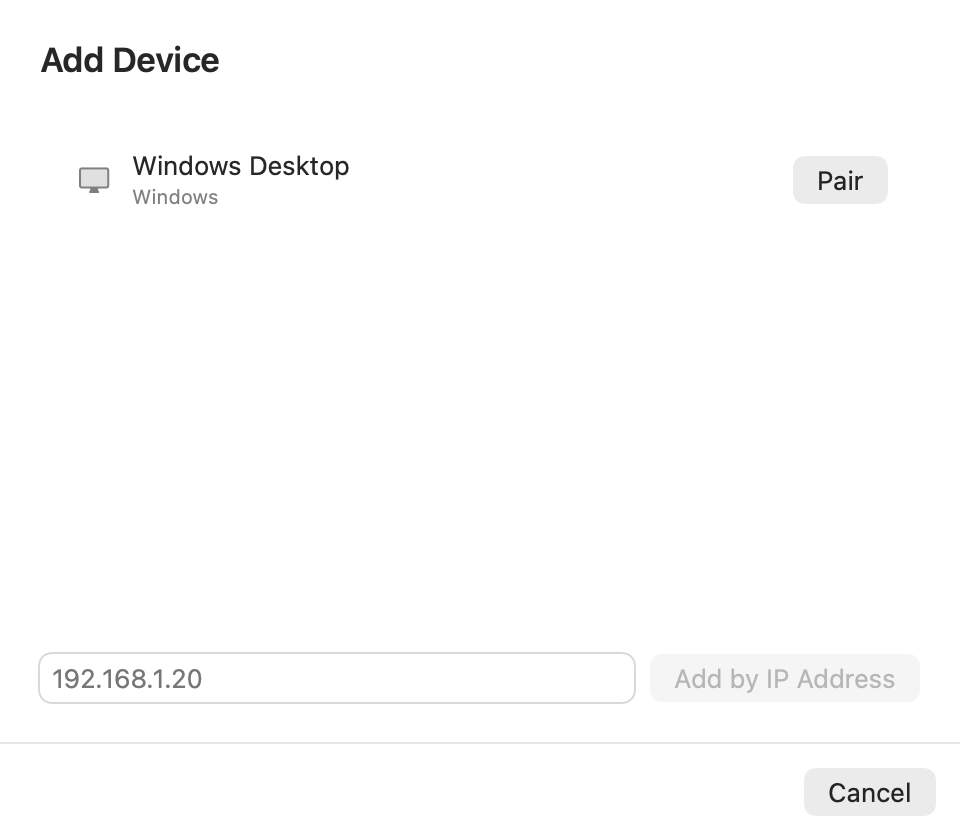
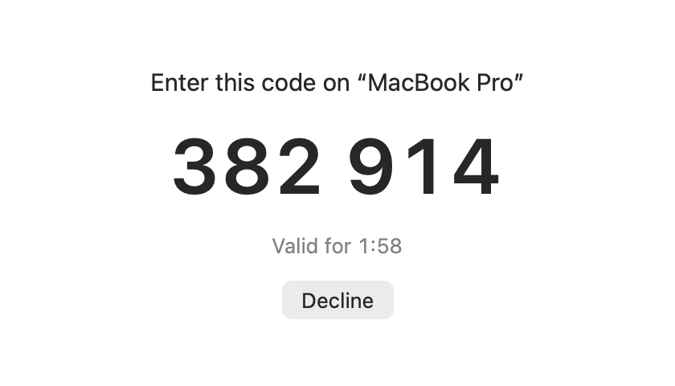
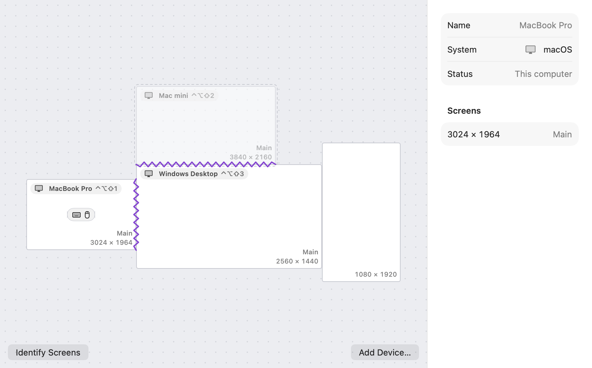
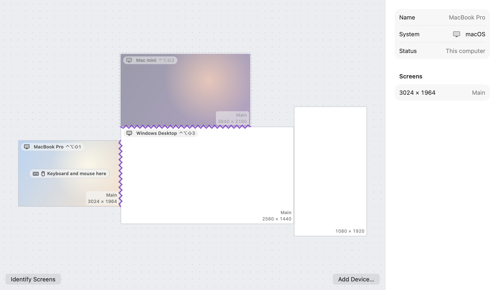
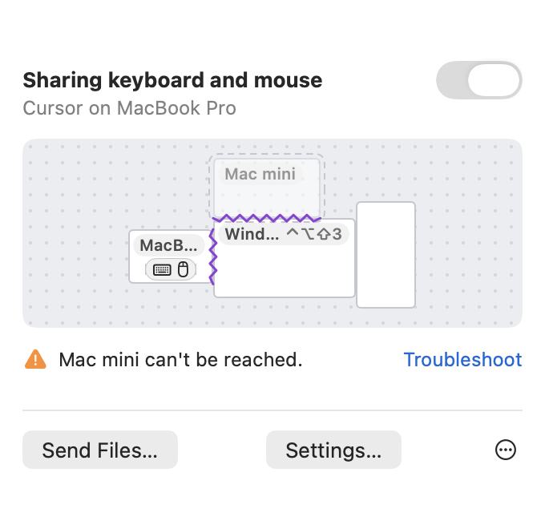
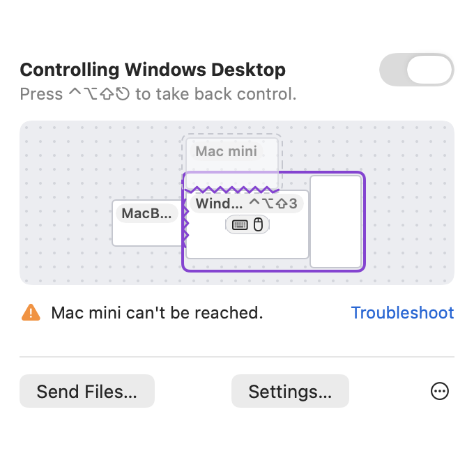
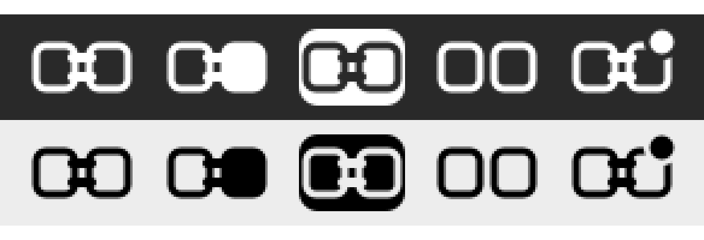
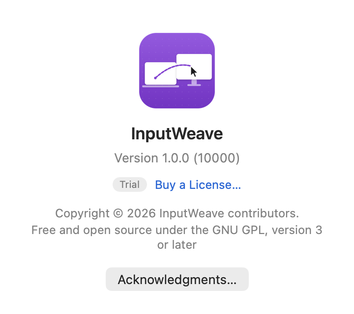

# InputWeave 使用指南

[English](user-guide.md) · **繁體中文**

本文是英文版使用指南的翻譯；兩者不同時以英文版為準。

InputWeave 讓桌上的幾台電腦共用一組鍵盤滑鼠。游標移出螢幕邊緣，就會出現在旁邊那台電腦上；在一台複製的內容，到另一台可以直接貼上；檔案拖到另一台電腦上就送過去。

InputWeave 支援 macOS 15 以上、Windows 10 22H2 或 Windows 11（x64），以及 Ubuntu 24.04 以上與 Debian 13（amd64 與 arm64）。從 [GitHub 的最新版本](https://github.com/tasict/InputWeave/releases/latest)下載。本文的截圖是 macOS App 的英文介面；每個 App 也都有繁體中文。

## 1. 安裝

### macOS（15 以上）

1. 打開安裝檔 `InputWeave-<版本>.pkg`，照安裝程式的步驟安裝。InputWeave 會裝進「應用程式」，裝好後自動打開。安裝檔以 Developer ID 簽章並經 Apple 公證。
2. 第一次打開會進入「設定 InputWeave」，照步驟完成即可（見第 2 節）。

**更新**經 InputWeave 的網站 inputweave.ctsite.cc 取得。有新版本時，InputWeave 會提示更新（Sparkle 的更新視窗）；也可以在面板的 ⋯ 選單選「檢查更新…」，或在「設定 › 一般 › 更新」關掉「自動檢查更新」。安裝更新時要輸入管理者密碼，InputWeave 會結束、安裝、再打開新版；新版發現背景服務還是舊的，會自己重新啟動它，換成新版。配對資料與設定都會保留。也可以照同樣的方式自己打開新版本的 `.pkg` 安裝。不要把 App 直接拖進「應用程式」覆蓋舊版：安裝檔裝的 App 屬於系統（root），而且 App 與背景服務都還在執行，拖曳覆蓋會失敗。

InputWeave 住在選單列。設定、首次設定或「關於」視窗開著時，它也會出現在 Dock 與 ⌘-Tab，視窗被其他 App 蓋住時可以從那裡切回來；這些視窗都關掉後，就只留在選單列。

### Windows（10 22H2 以上、11）

執行 `InputWeave-<版本>-x64.msi`。安裝時會跳出一次 UAC；安裝檔目前還沒有程式碼簽章，Windows 可能還會請你確認。安裝程式會：

- 安裝 InputWeave 服務，開機後自動執行，也能操作登入畫面與 UAC 提示。
- 安裝 InputWeave App，並在「開始」功能表加上「InputWeave」。
- 允許 InputWeave 在防火牆上接受**同一個區網**的連線。
- 讓服務可以替你按 Ctrl+Alt+Del（「軟體安全注意序列」原則）。

裝好後 InputWeave 會自動打開，出現在工作列右側的系統匣（通知區域）。Windows 11 會把新的圖示先收進「^」裡；要讓它一直顯示在工作列上，打開「設定 › 個人化 › 工作列 › 其他系統匣圖示」，把 InputWeave 打開，或直接把圖示從「^」拖到工作列上。之後要再打開 App，從「開始」功能表點「InputWeave」。

**更新**經 InputWeave 的網站 inputweave.ctsite.cc 取得。「設定 › 一般 › 更新」每天檢查一次（「自動檢查更新」，預設開啟），也有「立即檢查」。有新版本時，系統通知與一般頁上方的提示列會告訴你；「查看更新」列出新功能與修正，按「安裝」會下載、以 InputWeave 的簽章檢查檔案，跳一次 UAC 後安裝。安裝時鍵鼠共享會暫停約一分鐘，完成後 InputWeave 會自己重新開啟。下載的檔案和簽章不符時什麼都不裝。也可以自己執行新版本的 `.msi`。配對資料與設定都會保留。

- **按左鍵**打開面板：鍵鼠共享的狀態與開關、各台電腦的排列（有桌面背景，鍵盤與滑鼠圖示標出鍵鼠在哪台；點一台就把游標移過去）、無法連線的電腦、傳輸中的檔案與剪貼簿的狀態，還有「傳送檔案…」與「設定…」。InputWeave 服務停止時，面板上的「啟動服務」會跳出 UAC 把它啟動。
- **按右鍵**是選單：暫停共享（或繼續共享）、鎖定在這台電腦（或解除鎖定，也可以按 Ctrl + Alt + Shift + L）、識別螢幕、新增裝置…、設定…、檢查更新…、結束 InputWeave…。結束 App 只會收起圖示，InputWeave 服務仍在背景共享鍵鼠；要停止共享，請用「暫停共享」。
- **設定視窗**有一般、裝置、排列、檔案傳輸、疑難排解五頁，導覽窗格最下面另有「授權」，用法和 macOS 相同（第 3 節起）：在排列頁拖曳電腦、按「識別螢幕」、選一台看它的螢幕與延遲，為它取一個只在這台用的名稱、關閉和它同步剪貼簿或互傳檔案、設定「交換 ⌘ 與 Ctrl」或移除；在裝置頁按「新增裝置…」配對另一台；在一般頁改這台的名稱、設定登入時開啟、隱藏系統匣圖示（再開一次 InputWeave 就會出現）、選擇怎麼切換到另一台電腦、修改快速鍵。這台的記錄資料夾只有系統管理員能開，疑難排解頁會寫出它的位置；回報問題時用「匯出診斷資料…」即可。
- **被別台配對時**，這台的螢幕中央會出現配對碼，在另一台輸入即可，這台不必操作；不想配對就按「拒絕」。InputWeave App 沒開著時，會先自動打開它再顯示配對碼。

**首次設定（Windows）**：App 第一次開啟時會出現「設定 InputWeave」，最多 7 步，底部顯示「第 n 步，共 N 步」，除了第一步都可以按「上一步」：

1. **歡迎**：按「開始設定」。
2. **命名**：其他電腦會看到這個名稱，之後可以在「設定 › 一般」修改。
3. **網路檢查**：只有目前的網路設定為「公用」時才有這一步，因為其他電腦可能找不到這台。按「開啟網路設定」，在「設定 › 網路和網際網路」打開這個網路的內容，選擇「私人網路」；改好後畫面會自動打勾。也可以按「略過」。
4. **連接另一台**：在另一台電腦安裝並開啟 InputWeave，它就會出現在清單中，按「配對」；找不到時輸入 IP 位址。還沒有另一台時按「稍後再說」。
5. **輸入配對碼**：輸入另一台螢幕上的 6 位數（見第 3 節），成功後按「繼續」。
6. **排列**：把那台電腦拖到它在桌上的實際位置。
7. **試試看**：把游標移向那台電腦，成功後會寫出切回這台的快速鍵。按「完成」。

之後要重新看一次，從系統匣右鍵選單或面板的 ⋯ 選「重新執行設定…」。

**傳送到**：InputWeave 第一次執行時，會把自己加進檔案總管的「傳送到」選單（見第 7 節）。

### Linux（Ubuntu 24.04 以上、Debian 13）

依電腦的架構下載 `inputweave_<版本>_amd64.deb`（一般的 PC）或 `inputweave_<版本>_arm64.deb`（ARM 電腦，例如 Apple 晶片 Mac 上的虛擬機），在終端機安裝：

```sh
sudo apt install ./inputweave_<版本>_amd64.deb
```

apt 會一併裝好需要的 GTK 4 與 libadwaita。套件會：

- 安裝背景服務 `/usr/bin/inputweave` 與 App `/usr/bin/inputweave-app`，在應用程式選單加上「InputWeave」。
- 加入 InputWeave 的套件來源 `/etc/apt/sources.list.d/inputweave.sources` 與它的簽章金鑰：經 inputweave.ctsite.cc 取得、以 InputWeave 的金鑰簽章的套件。
- 為每個使用者啟用背景服務：它是使用者自己的 systemd 服務 `app-cc.ctsite.inputweave@agent.service`，**下一次登入**時跟著桌面一起啟動，登出時結束。GNOME 與 KDE Plasma 由桌面自己啟動它；Cinnamon、Xfce、MATE 這類不啟動 `graphical-session.target` 的桌面，由登入時的自動啟動項目代為啟動（每次登入都重新啟動一次，讓它用這次登入的顯示；這些桌面登出時不會結束它）。裝好後不想登出的話，可以先執行 `systemctl --user start app-cc.ctsite.inputweave@agent.service`。

**更新**跟著系統的軟體更新一起送到（「軟體」、Discover，或 `sudo apt update && sudo apt upgrade`），來源是套件加入的套件來源。已在執行的背景服務要等下次登入（或執行 `systemctl --user restart app-cc.ctsite.inputweave@agent.service`）才會換成新版；App 開著（或下次打開）時發現背景服務還是舊版，會自己重新啟動它。配對資料與設定都保留。

從應用程式選單打開「InputWeave」，第一次會進入首次設定。App 的圖示在面板的狀態區（KDE Plasma；Ubuntu 的 GNOME 已內建 AppIndicator 擴充套件；Debian 的 GNOME 要另外安裝並啟用 `gnome-shell-extension-appindicator`，沒有的話 App 會改為直接打開視窗）。關掉視窗後 App 仍留在狀態區；不論 App 開著與否，共享都由背景服務在背景進行。「設定 › 一般 › 登入時開啟 InputWeave」決定登入時要不要讓圖示出現（預設是關的，和 macOS、Windows 一樣）；需要你決定的事（配對碼、「每次詢問」收到的檔案）會自動打開 App。

**防火牆**：安裝不會改防火牆。Ubuntu 預設沒有開 ufw；你自己開了的話，其他電腦會連不上這台，執行一次 `sudo ufw allow InputWeave` 即可（允許 UDP 47820 與 mDNS 的 5353；設定檔改了 `[network] listen` 的 port 時，另外 `sudo ufw allow <port>/udp`）。用 firewalld 的話，裝好後先 `sudo firewall-cmd --reload` 讓它讀到 InputWeave 的設定，再 `sudo firewall-cmd --add-service=inputweave --permanent`、`sudo firewall-cmd --reload`。`inputweave ctl status` 的 `firewall:` 一行說明它看到的情況（ufw 的規則只有 root 讀得到，所以通常只看得出 ufw 開著；讀得到時會說是哪個 port 被擋：47820 被擋是連不上，5353 被擋是找不到這台）。

**Wayland 與 X11**：Ubuntu 與 Debian 預設是 Wayland。Wayland 上 InputWeave 經由桌面的「遠端桌面」與「輸入擷取」功能（portal）控制這台與讀取這台的鍵鼠，所以桌面會詢問你：

- **讓其他電腦控制這台**（「遠端桌面」或「遠端互動」）：首次設定或「設定 › 疑難排解」要求時詢問一次，選「允許」後會記住，之後登入不再問。你從桌面的指示器停止分享後，要在 App 裡再允許一次。
- **用這台的鍵鼠控制其他電腦**（「輸入擷取」）：GNOME 每次背景服務啟動（通常是每次登入）都會詢問一次，這是桌面目前的限制。

在登入畫面選「Ubuntu on Xorg」之類的 X11 工作階段時，不會有這些詢問。

**Linux 的限制**：

- Wayland 上，游標碰到通往其他電腦的邊緣之後，InputWeave 才收得到這台的鍵鼠。所以沒在控制其他電腦時，鎖定與跳轉的快速鍵、搖動滑鼠找游標都沒有作用（推著邊緣等著跨過去時按跳轉快速鍵則有效）；這台被別台控制時，動這台自己的滑鼠也不會把控制收回來：在控制端按切回快速鍵，或在這台系統匣的選單選「暫停共享」（暫停期間其他電腦也不會控制這台）。
- Wayland 上不能直接跳到其他電腦：排列頁的「把游標移到這裡」是停用的，名稱旁也不標跳轉快速鍵，App 會寫出原因。跳回這台照常可以。
- Wayland 上游標推到通往其他電腦的邊緣時，桌面會先把鍵鼠交給 InputWeave：設了停留時間或「按住修飾鍵才切換」而沒跨過去時，那時按下的滑鼠鍵或按鍵不會給這台的 App（游標離開邊緣就恢復）。
- Wayland 上按住滑鼠鍵拖曳（例如拖視窗）推到通往其他電腦的邊緣，可能會跨過去：InputWeave 在那裡才拿到鍵鼠，不知道鍵已經按著。
- Wayland 上控制其他電腦時，捲動方向依這台的「自然捲動」設定還原成滾輪實際轉的方向：滾輪依滑鼠的設定、觸控板依觸控板的設定（GNOME 與 KDE；其他桌面不還原）。滑鼠與觸控板的設定不同、又用會平滑捲動的滑鼠時，方向可能不對。
- 跨電腦拖曳檔案在 Linux 上不能用。請改用「傳送檔案…」、把檔案拖到排列畫布上的電腦，或在檔案管理員複製、到另一台貼上。
- 畫面上方的提示：X11 與 KDE Plasma 上是浮在畫面上的提示，GNOME 的 Wayland 上改為系統通知。「識別螢幕」在 Wayland 上會在每個螢幕各開一個全螢幕視窗，幾秒後自己關掉。找游標（搖動滑鼠時放大游標）只有 X11 有；GNOME 有自己的「定位游標」（設定 › 協助工具）。
- X11 上每個螢幕的縮放都當成 100%，排列畫布上的大小是像素。
- 登入畫面無法從其他電腦操作：背景服務是登入後才啟動的使用者服務。
- sway、Hyprland、river 這類 wlroots 系的合成器上，InputWeave 用它們自己的虛擬鍵鼠與螢幕邊緣的透明 surface，不經過 portal，也沒有要允許的。游標推到通往其他電腦的邊緣時，這台的鍵盤暫時交給 InputWeave（原本的視窗暫時失去鍵盤，沒跨過去就還回來）。通往其他電腦的那段邊緣上，最外一排像素是 InputWeave 的：在那一排點擊、捲動或移過去都不會到下面的 App（例如 waybar 或捲軸剛好在那條邊上時），推了沒跨過去之後也一樣；其他邊緣不受影響。在 App 裡按著滑鼠鍵（例如拖曳）時推到那條邊跨不過去，先放開再推。這些桌面把虛擬鍵鼠交給每個程式，桌面本身沒有允許的對話框，所以在這些桌面上啟用 InputWeave 就是同意讓其他電腦控制這台；GNOME 與 KDE 一律經過桌面的允許對話框。螢幕鎖定時，只有系統（logind）知道已鎖定，其他電腦才不會進入這台；swaylock 預設不告訴 logind，所以鎖定時其他電腦仍可能進入、打的字會進到 swaylock 的密碼欄。還沒在真的 sway、Hyprland 上試過。

## 2. 首次設定（macOS）

設定共 8 步，畫面底部會顯示「第 n 步，共 8 步」。除了第一步，每一步都可以按「上一步」回去看，已經完成的動作（允許在背景執行、命名）不會重做。

1. **歡迎**：你需要另一台在同一個網路上的電腦，整個設定大約 5 分鐘。按「開始設定」。
2. **在背景執行**：按「允許在背景執行」。如果系統要求核准，到「系統設定 › 一般 › 登入項目與延伸功能」打開 InputWeave，再回到設定畫面。
3. **權限**：在「系統設定 › 隱私權與安全性」打開「InputWeave Agent」。設定畫面會依你的 macOS 版本寫出要打開哪個清單：
   - macOS 27 以後：「裝置控制和資料取用」清單。打開後「輸入監控」會一起打勾，不必另外設定。
   - macOS 15、26：「輔助使用」和「輸入監控」兩個清單都要打開。

   背景服務開始執行時，macOS 會跳出詢問視窗，按裡面的「打開系統設定」就會到這個清單；也可以按設定畫面上的「打開系統設定」。畫面每秒檢查一次，打開後自動打勾，背景服務也會自動重新啟動一次。
   - 輔助使用：讓這台的鍵鼠控制其他電腦，也讓其他電腦控制這台。
   - 輸入監控：偵測游標什麼時候碰到螢幕邊緣。
4. **檔案與資料夾**：InputWeave 傳送你拖曳或選擇的檔案、把收到的檔案存到「下載項目 › InputWeave」或你拖放的位置時，會用到「下載項目」「桌面」「文件」這三個資料夾，macOS 對每個資料夾都會問一次能不能使用；通知也要先問過。按「允許存取」，macOS 會依序詢問這三個資料夾（一次一個），每個都選「允許」，接著詢問通知。這樣第一次傳送或拖曳檔案時就不會被詢問打斷。按「稍後再說」也可以，之後第一次用到時 macOS 才會問。
   - 選了「不允許」的資料夾，之後可以在「系統設定 › 隱私權與安全性 › 檔案和檔案夾」為「InputWeave」打開。
   - 網路磁碟區與外接磁碟沒辦法事先詢問：第一次從那裡傳送檔案、或把檔案拖放到那裡時，macOS 才會問。
5. **命名**：其他電腦會看到這個名稱，之後可以在「設定 › 一般」修改。
6. **連接另一台**：在另一台電腦安裝並開啟 InputWeave，它就會出現在清單中。按「配對」（見第 3 節）。找不到時，可以按「用 IP 位址新增」。這時 macOS 可能會詢問 InputWeave 能不能尋找本機網路上的裝置，請選「允許」，否則找不到其他電腦。還沒有另一台時，可以按「稍後再說」。
7. **排列**：把新電腦拖到它在桌上的實際位置。
8. **試試看**：把游標移向那台電腦。

## 3. 配對

只有配對過的電腦才能互相控制。配對時：

1. 在有鍵鼠的那台，打開「設定 › 裝置 › 新增裝置…」，在清單中按「配對」。
2. 另一台的螢幕中央會出現 6 位數配對碼，2 分鐘內有效。那台**不需要任何操作**；如果不是你發起的，按「拒絕」。那台的 InputWeave App 沒開著時，背景服務會先打開它。
3. 在第一台輸入這組配對碼。輸入錯誤可以再試，連錯 3 次要重新開始。只要輸錯過，那次配對結束後 30 秒內不能重新配對。

 

左：在有鍵鼠的那台選擇要配對的電腦。右：另一台顯示的配對碼。（本文的截圖都是英文介面。）

配對完成後，兩台會記住彼此，之後開機會自動連線。要移除裝置，在「設定 › 裝置」選取它，按「移除裝置…」。

## 4. 排列

「設定 › 排列」顯示每台電腦和它的螢幕，大小依實際比例。

<picture>
  <source media="(prefers-color-scheme: dark)" srcset="screenshots/arrangement-dark.png">
  
</picture>

- 拖曳整台電腦，放到它在桌上的位置。靠近其他電腦時會自動吸附，兩台相接的邊會出現縫線，游標就是從縫線穿過去。不必排得完全貼齊：沒有縫線的邊，只要那一側有其他電腦，游標也會到那台離它最近的位置，中間的空隙會直接跳過。
- 一台電腦內各螢幕的相對位置，跟隨那台作業系統自己的顯示器設定。
- 放到會和其他螢幕重疊的位置時，電腦會彈回原處。
- 也可以用方向鍵微調選取的電腦。
- 排列會自動同步到所有已連線的電腦。
- 在電腦上按右鍵，選「把游標移到這裡」，游標就直接到那台主螢幕的中央，不必一路推過去。
- **識別螢幕**：分不清畫布上哪塊是桌上的哪個螢幕時，按排列頁左下角的「識別螢幕」（面板的 ⋯ 選單也有）。這台和所有已連線的電腦，會在自己的每個螢幕中央大字顯示自己的名稱，下面寫「螢幕 1・3024 × 1964」（第幾個螢幕依排列裡那台螢幕的順序，後面是像素），螢幕四邊加上紫色的框，約 2.5 秒後淡出；打開「減少動態效果」時直接消失。連按也是一秒最多一次。Windows 也一樣：排列頁左下角與系統匣、面板 ⋯ 選單都有「識別螢幕」，卡片上另外寫出跳到這台的快速鍵（例如 Ctrl + Alt + Shift + 1）；「設定 › 協助工具 › 視覺效果 › 動畫效果」關閉時直接消失。Windows 的 InputWeave App 要在執行中才會顯示。
- **為其他電腦取名字**：選取另一台電腦，在右側最上面的「名稱」欄輸入新的名稱，按 Return（Windows 是 Enter）或點別處就生效（也可以在那台電腦上按右鍵選「重新命名…」）。這個名稱只在這台電腦上使用：排列、面板、通知、傳輸紀錄與 `inputweave ctl` 都改用它，但那台電腦本身和其他電腦都不知道，它們照樣用那台自己取的名稱。改過名稱時，欄位下面會寫「這台電腦自稱「…」」，也就是那台自己取的名稱；把欄位清空就改回那個名稱。這台自己的名稱在「設定 › 一般」修改，會同步給其他電腦。
- 選取電腦時，右側會顯示它的狀態，例如「已連線・3 ms」：3 ms 是兩台之間來回一趟的時間（延遲），每幾秒更新一次，還沒量到時只顯示「已連線」。「設定 › 裝置」的清單也會顯示。
- 鍵盤與滑鼠圖示的小標籤「鍵鼠在這台」標出共享的鍵鼠現在在哪一台，放在那台的主螢幕上；螢幕太窄時只顯示圖示。

**桌面背景縮圖**：排列頁與選單列面板的小地圖，會用每台電腦的桌面背景當它螢幕的底，一眼就認出哪塊是哪台。縮圖上蓋著一層淡淡的螢幕色，名稱、縫線和解析度都看得清楚。每台電腦會把自己桌面背景的小縮圖（最長邊 320 像素）傳給已配對、已連線的電腦，換了桌布後約一分鐘內更新；縮圖只在你的電腦之間傳送，對方的縮圖存在這台的設定資料夾裡，離線時仍看得到（和那台一起淡化），取消配對就刪除。

不想分享時，到「設定 › 一般 › 桌面背景」關閉「把這台的桌面背景分享給已配對的電腦」，其他電腦會立刻清掉這台的縮圖，改回素色的螢幕。以下情況看不到某台的縮圖，那台的螢幕維持素色：

- 那台關閉了分享。
- 那台的桌面背景是純色。
- 那台 Windows 電腦停在登入畫面：桌面背景要有人登入後才讀得到，登入前不會傳送縮圖（登出後也會清掉）。
- 那台 Mac 的螢幕是在背景服務執行中才接上的：可能要等背景服務重新啟動（例如登出再登入）才有縮圖。
- 配對後那台還沒連線過。

<picture>
  <source media="(prefers-color-scheme: dark)" srcset="screenshots/arrangement-pictures-dark.png">
  
</picture>

## 5. 日常使用

- **切換**：游標碰到縫線就會到另一台電腦，鍵盤輸入也跟著過去。碰到沒有縫線的邊時，只要那一側有其他電腦，游標就移到那一側最近的螢幕上離它最近的點，接著繼續移動（最近的是同一台電腦自己的另一個螢幕時，游標停在原處，和系統平常一樣）；螢幕角落附近一小段不會切換，留給熱角使用。
- **切回這台**：按 ⌃⌥⇧⎋（Control-Option-Shift-Esc），鍵鼠立刻回到有實體鍵鼠的這台。這個快速鍵永遠不會傳給其他電腦。也可以在「設定 › 一般 › 快速鍵」打開「連按兩下 ⌃ 切回這台」（Windows 與 Linux 是「連按兩下 Ctrl 切回這台」）：控制其他電腦時，快速按下並放開同一個 Control 鍵兩次（兩次都在 400 毫秒內，中間不按其他按鍵、不點滑鼠、不捲動），也會切回這台。這兩下 Control 都會送到那台，所以那台若有單獨按 Control 就會作用的功能，請不要打開這個選項：例如 macOS 把聽寫的快速鍵設成按兩下 Control、GNOME 的「定位指標」（按 Ctrl 時標出指標在哪裡），或是對 Windows 電腦打開了「交換 ⌘ 與 Ctrl」（送到那台的是 Windows 鍵，會打開又關上「開始」功能表）。相對滑鼠開著時不作用，因為遊戲常用 Ctrl（例如蹲下），這時請用快速鍵。打開後面板的副標會寫出兩種方法。預設關閉；也可以用 `inputweave ctl hotkeys set --take-back-double double+control`（`""` 是關閉）。
- **直接跳到某台**：在選單列面板的小地圖上點一台電腦，游標就到那台主螢幕的中央；點這台就回到這台。暫停共享或鎖定時不會跳；那台沒有連線時，它會左右晃一下。
- **用快速鍵跳到第 N 台**：按 ⌃⌥⇧ 加數字 1 到 9，游標就到那台主螢幕的中央。排列中的電腦（含這台、含目前離線的）依排列頁上的位置由左到右編號，左緣一樣時由上到下；編號對應的快速鍵寫在排列頁與小地圖的電腦名稱旁，以及「裝置」頁的清單裡。那台沒有連線、暫停共享或鎖定時，按了什麼都不會發生。這組按鍵不會傳給其他電腦。
- **鎖定在目前的電腦**：玩遊戲或需要精準操作時，按 ⌃⌥⇧L（Control-Option-Shift-L），游標碰到邊緣也不會切換，留在現在這台（不論是這台還是正在控制的那台）；再按一次解除。這個快速鍵也不會傳給其他電腦。也可以從面板的 ⋯ 選單選「鎖定在這台電腦」或「解除鎖定」。鎖定時，面板標題會寫「已鎖定在」那台的名稱，畫面上方也會提示。鎖定期間按 ⌃⌥⇧⎋ 照樣切回這台，但鎖定不會解除，游標接著留在這台。暫停共享不會解除鎖定；結束 InputWeave 或背景服務重新啟動後會解除。在 macOS 上，⌃⌥⇧L 不會傳給這台的 App；在 Windows 上，沒在控制其他電腦時，這組按鍵仍會傳給這台的 App。
- **遊戲用的相對滑鼠**：很多遊戲（尤其是第一人稱視角的）會把游標藏起來、鎖在視窗裡，只讀滑鼠移動了多少。控制另一台電腦玩這種遊戲時，按 ⌃⌥⇧G（Control-Option-Shift-G；Windows 是 Ctrl + Alt + Shift + G）切換成相對滑鼠：滑鼠的移動原樣送到那台，游標不會跨到其他電腦，遊戲就能正常轉動視角；再按一次回到平常的方式。按 ⌃⌥⇧⎋ 切回這台、用快速鍵跳到別台、那台斷線或鎖定時也會自動結束。這組按鍵不會傳給其他電腦；游標在這台時，它是這台 App 的一般按鍵。被控制的是 Windows 時，遊戲把游標藏起來並鎖在視窗裡，InputWeave 會自動切換成相對滑鼠，遊戲放開游標（例如打開選單）時自動回到平常的方式（最多晚 1 秒）；不想自動切換，到「設定 › 一般 › 切換」關掉「遊戲抓住滑鼠時自動切換成相對滑鼠」（或用 `inputweave ctl relative --auto off`）。自動切換後按 ⌃⌥⇧G 手動結束時，會維持手動的選擇，直到遊戲下一次抓住或放開游標。Mac 沒有可靠的方法得知遊戲是否抓住游標，被控制的是 Mac 時只能手動切換。相對滑鼠結束後，游標從那台游標當時的位置接著移動。只藏游標、不鎖在視窗裡的遊戲不會自動切換，請手動切換。兩台都要是支援這個功能的版本；對方的版本太舊時，⌃⌥⇧G 不會切換，會照常當成一般按鍵傳給那台，畫面上方會說那台的版本不支援相對滑鼠。切換成相對滑鼠時，畫面上方會提示「相對滑鼠：游標鎖在「Windows 桌機」。按 ⌃⌥⇧G 結束。」，面板標題寫「相對滑鼠：」加那台的名稱；結束時，以及遊戲放開游標而自動結束時，也會提示；遊戲自動切換的提示，同一台電腦第一次之後一分鐘最多出現一次，免得遊戲每次打開選單都跳出來。選單列與系統匣的圖示和平常控制其他電腦時相同。這組快速鍵在「設定 › 一般 › 快速鍵」的「切換相對滑鼠（遊戲）」修改，右邊的開關可以關閉它（關閉後只能自動切換或用命令列）。也可以用命令列的 `inputweave ctl relative on`／`off`（見第 9 節）與 `inputweave ctl hotkeys set --relative …`（`--relative ""` 關閉）。從之前的版本更新時，若這台已經有快速鍵是 ⌃⌥⇧G，那組照舊，相對滑鼠的快速鍵先關閉，要用時再設定。
- **停留片刻才切換**：怕游標不小心切過去，到「設定 › 一般 › 切換」打開「停留片刻才切換」，游標要在邊緣推住一下（150 毫秒）才會切換。推一下就停住不會切換，往回移開邊緣就重新計時。要用其他時間，可以用命令列的 `inputweave ctl dwell`（見第 9 節）；用它設過的值，在 App 這次執行期間關掉再打開這個選項還會沿用。
- **跨過去時邊緣會亮一下**：游標跨到另一台時，離開的螢幕與進入的螢幕上，跨過的那條邊會整條短暫亮起紫色的光（不到一秒，跨過去的地方最亮），讓你知道游標去了哪裡。用快速鍵或小地圖跳過去時不會亮。不想要的話，到「設定 › 一般 › 切換」關掉「游標跨到其他電腦時，在螢幕邊緣顯示光」；這是每台電腦各自的設定。開著「減少動態效果」（Windows 是關掉「動畫效果」）時光直接出現再消失，不做淡入淡出；Windows 在玩全螢幕遊戲或簡報時不亮。Linux 上 X11 與 KDE Plasma 也有（X11 沒有合成器時是一條細的實線，不會淡入淡出）；GNOME 的 Wayland 上 App 不能在畫面上繪製，所以沒有這個效果。
- **按住修飾鍵才切換**：「設定 › 一般 › 切換」的「切換到另一台電腦」選「按住 ⇧ 時」（或 ⌃、⌥、⌘），游標只有在按著那個鍵時才會跨過縫線，往回也一樣；沒按著時游標停在邊緣。用快速鍵或小地圖跳到某台不受影響。按著跨過去的那個鍵不會在另一台按下。也可以用 `inputweave ctl edge --modifier shift`（`none` 是不需要）。
- **修改快速鍵**：「設定 › 一般 › 快速鍵」列出切回這台、鎖定在目前的電腦、跳到第 N 台電腦、切換相對滑鼠（遊戲）四組（背景服務是不支援相對滑鼠的舊版時，沒有最後一組），切回這台下面還有連按兩下 Control 的開關（背景服務是舊版時沒有）。按「錄製」再按下新的組合；單獨按 Esc 取消，單獨按 Delete 回到那一組的預設值。切回這台與鎖定在目前的電腦可以是至少有一個修飾鍵的組合，也可以只用一個打字用不到的按鍵：F13–F19、Scroll Lock 或 Pause；相對滑鼠那一組至少要有一個修飾鍵。Mac 不會回報 Scroll Lock 與 Pause，所以 Mac 上是 F13–F19（Apple 延伸鍵盤上的 Scroll Lock 就是 F14，錄下來也是 F14）。在 Windows 上，很多鍵盤把 Ctrl 加 Scroll Lock 送成 Ctrl 加 Pause，兩者分不出來。在 Linux 的 X11 上，桌面自己已經用了的按鍵（F13–F19 可能是，例如當成 XF86Tools）照樣可以當快速鍵，但也會傳給桌面；其他快速鍵照常不傳給 App。單一按鍵不論同時按著哪些修飾鍵都算，所以鎖定是單一按鍵時，其他快速鍵不能是同一個按鍵加修飾鍵。跳到第 N 台那一組只要按修飾鍵（至少一個）加任一個數字，右邊的開關可以整組關閉；相對滑鼠那一組也有開關。兩組不能相同，跳轉的修飾鍵加某個數字也不能和另外兩組相同。「重設快速鍵」全部改回預設值，也關掉連按兩下。錄製時，目前的快速鍵照樣有作用（例如按目前的鎖定組合會切換鎖定），所以錄不到正在使用的組合。每台電腦的快速鍵各自設定，控制其他電腦時用的是你手上這台的。也可以用命令列的 `inputweave ctl hotkeys`（見第 9 節）。
- **找游標**：找不到游標時，快速左右搖動滑鼠，游標所在的那台電腦上的游標會放大到 4 倍、停一下再縮回原本大小（約 1 秒），放大時一樣跟著滑鼠移動；面板小地圖上的鍵盤與滑鼠圖示也會跳一下。打開「減少動態效果」（Windows 是「設定 › 協助工具 › 視覺效果 › 動畫效果」關閉）時，游標直接以 3 倍大顯示 1 秒。Mac 上放大的一律是箭頭的形狀。Windows 的 InputWeave App 要在執行中才會顯示。
- **自動切回**：對方斷線、對方有人動了它自己的滑鼠，鍵鼠都會自動回來，畫面上方會說明原因。
- **⌘ 與 Ctrl**：控制 Windows 時，可以在「設定 › 排列」選取那台電腦，勾選「交換 ⌘ 與 Ctrl」，用習慣的 ⌘C、⌘V 操作。
- **另一台電腦上的游標速度**：游標在另一台電腦上覺得太慢或太快時（例如很大或解析度很高的螢幕），在「設定 › 排列」或「裝置」選取那台電腦，拖動「游標速度」，從 50% 到 300%，每格 10%：游標在那台上時，滑鼠移動的距離乘上這個倍率；不是 100% 時旁邊有「重設」，回到 100%。跨到那台、從那台跨回來的位置照樣是縫線所在的地方。這是這台自己的設定：只在這台控制那台時套用（別台控制它時用別台自己的設定），不改變那台自己的滑鼠，遊戲用的相對滑鼠不受影響，移除那台之前都保留（再配對一次也保留，即使那台的裝置 id 改了）；離線的電腦也能調。這台的背景服務是舊版時不顯示這個設定。命令列：`inputweave ctl device <裝置 id> --speed 150`（第 9 節）。
- **喚醒睡著的電腦**：每台電腦連上時會告訴其他電腦怎麼經由網路喚醒它，其他電腦會記住。它離線時，在「設定 › 排列」或「裝置」選取它：狀態寫「離線・2 小時前」，旁邊的「喚醒」會送出網路喚醒（排列頁的右鍵選單也有「喚醒」；排列頁、選單列面板的小地圖與裝置清單在名稱後面加上月亮，標出能喚醒的電腦）。之後狀態寫「正在喚醒…」，最多兩分鐘，醒來時會有提示。兩分鐘內沒有連上的話，會寫它沒有醒來，並附上[怎麼打開網路喚醒](#wake-for-network-access)的連結；再按「喚醒」就再試一次。還沒告訴這台怎麼喚醒它的電腦會這樣寫，下次連上之後就能喚醒。網路喚醒只對打開了網路喚醒的電腦有效，多半只在有線網路上有效，而且要和這台在同一個網路：喚醒是一則廣播，路由器不會轉送。要在把游標推向那一側的螢幕邊緣時喚醒它（像要跨過去那樣），打開「設定 › 一般 › 切換」的「把游標推向睡眠中的電腦時喚醒它」（預設關）：「停留片刻才切換」與「切換到另一台電腦」對推游標和跨過去一樣適用；同一台在 30 秒內送過喚醒的話（推游標或按「喚醒」送的都算），推游標不會再送。在 Wayland 的 Linux 電腦上推游標不會喚醒任何電腦（游標只在通往已連線電腦的邊緣才會交給 InputWeave），請改用「喚醒」。InputWeave 是舊版的電腦不會告訴其他電腦怎麼喚醒它，所以不能這樣喚醒。命令列：`inputweave ctl wake <裝置 id>` 與 `inputweave ctl wake --push on`（第 9 節）。
- **暫時離線**：想讓某台電腦暫時脫離群組、又不想取消配對時，在「設定 › 排列」或「裝置」選取它，按「暫時離線」（排列頁的右鍵選單也有）；要讓這台自己暫時離線，在面板的 ⋯ 選單選「讓這台暫時離線」（Windows 的系統匣選單也有；Linux 在系統匣選單）。在有人恢復連線之前，沒有一台電腦會控制它或被它控制，剪貼簿與檔案兩個方向都不送；那一刻它正被控制的話，鍵鼠會立刻回來，它那邊也不會有按著沒放開的鍵。每一台電腦都把它顯示成「暫時離線」（淡化、虛線，名稱後面有斜線的網路圖示），並寫出是哪一台設定的；不能跳過去、不能喚醒，也不能傳檔案給它；已經在傳的檔案會停下來等它恢復連線，再從停下的地方繼續。整個群組都適用，重新啟動後照樣保留。任何一台都能按「恢復連線」讓它回來，包括被設為暫時離線的那台自己：它的面板會寫「這台暫時離線」、是哪一台設定的，並有「恢復連線」（Linux 在「設定 › 一般」與系統匣選單）；它暫時離線時，不能讓其他電腦暫時離線或恢復連線。在你操作的那台、以及被別台設為暫時離線的那台，會有提示說明哪台暫時離線或恢復連線。群組裡每台電腦都要是 InputWeave 1.1 以後的版本：還是 1.0 的電腦不認得暫時離線，和另一台 1.0 的電腦之間照樣互相控制、同步剪貼簿與互傳檔案，所以檢視器會對每一台已連線、還是 1.0 的電腦提出警告。命令列：`inputweave ctl offline <裝置 id> on|off`（第 9 節）。
- **情境**：想依所在的地方用不同的方式共享，例如在公司只連公司的那幾台、在咖啡店完全不共享，就用情境（「設定 › 情境」；見下面的[情境與網路](#profiles)）。面板的標題後面寫著目前的情境，情境自己換了時會有提示。
- **輸入密碼時**：macOS 的「安全鍵盤輸入」開著時（例如在密碼欄位），按鍵只會留在這台。
- **Mac 的鎖定畫面與登入視窗**：鎖定畫面與登入視窗只接受看起來是實體鍵鼠的輸入，InputWeave 要經由虛擬鍵盤與滑鼠才送得進去，這需要 Apple 核准的權限。「設定 › 一般 › 鎖定畫面」說明這台 Mac 能不能；不能時，這台鎖定期間游標不會移過去，其他電腦上它的狀態寫「螢幕已鎖定，無法輸入」。能的時候，可以再打開「讓其他電腦在登入視窗也能控制這台 Mac」（或 `inputweave ctl login-window on`）：從下一次出現登入視窗起（例如登出之後），其他電腦就能在那裡點選使用者、輸入密碼登入。它以最後登入的使用者在這台的配對與排列運作，所以要由那位使用者打開，而且要是用安裝檔安裝的 InputWeave；那位使用者還登入著（例如用「快速切換使用者」回到登入視窗）時，登入視窗不能從其他電腦操作。登入視窗那時不能配對新的電腦，也不收檔案或剪貼簿；其他電腦上這台的桌面背景照舊顯示上次看到的。開啟 FileVault 時，Mac 重新開機後會在 macOS 啟動前先要求密碼，那個畫面無法從其他電腦操作。
- **Windows 的快速鍵**寫成文字：切回這台是 Ctrl + Alt + Shift + Esc，鎖定是 Ctrl + Alt + Shift + L，跳到第 N 台是 Ctrl + Alt + Shift + 數字（排列頁、小地圖與裝置清單在名稱旁寫成 Ctrl+Alt+Shift+2）。修改快速鍵與「切換到另一台電腦」（按住 Ctrl、Alt、Shift 或 Windows 鍵時）都在「設定 › 一般」，用法和上面相同：按「錄製」後按下新的組合，單獨按 Esc 取消，單獨按 Delete 或 Backspace 回到預設值，背景服務不接受時卡片下面會用紅字說明原因（Linux 是那一列下面的紅字）。Windows 自己保留的組合（例如 Win + L、Win + 數字）錄不到。鍵鼠自動切回、鎖定或解除、相對滑鼠開始與結束，以及頭三次控制其他電腦時，Windows 的畫面上方一樣會出現提示，約 2.5 秒後淡出，滑鼠停在提示上時不會消失；提示不會搶走焦點，也不擋滑鼠點擊。

更新的方式見第 1 節：macOS 與 Windows 在 App 裡更新，Linux 跟著系統的軟體更新。

選單列面板的小地圖標出每台電腦的名稱，鍵盤與滑鼠的小圖示表示共享的鍵鼠現在在哪一台（被其他電腦控制時，圖示在這台）；螢幕以各台的桌面背景當底（第 4 節）；虛線淡化的是目前連不上的電腦。點一台電腦就跳過去，把檔案拖上去就傳送。正在控制其他電腦時，面板標題會寫出那台的名稱，那台的外框也會變成紫色。

<picture>
  <source media="(prefers-color-scheme: dark)" srcset="screenshots/panel-dark.png">
  
</picture>


選單列圖示會顯示目前的狀態。下圖上排是暗色選單列、下排是亮色，由左到右是：正常、正在控制其他電腦（右邊的螢幕變成實心）、被其他電腦控制中（整個圖示反白）、已暫停（縫線消失）、需要處理（右上角的圓點，見第 8 節）。



選單列面板的開關可以暫停共享。暫停共享時，這台不控制其他電腦，其他電腦也不能控制這台；正在被其他電腦控制時，鍵鼠會立刻回到這台。繼續共享後恢復。結束 InputWeave（面板右下角 ⋯ › 結束 InputWeave）會停止共享，直到下次登入或重新打開 App。在同一個確認視窗按「只隱藏選單列圖示」，共享會繼續，只是圖示不見了；要讓它再出現，從「應用程式」再開啟一次 InputWeave。「設定 › 一般 › 在選單列顯示」也可以隱藏或顯示圖示。

面板的 ⋯ 選單 › 「關於 InputWeave」顯示版本、版權與授權條款（InputWeave 是自由軟體，採用 GNU GPL 第 3 版或更新的版本），以及這台有沒有授權（第 12 節）；按「致謝…」可以看到 InputWeave 內含的第三方元件與它們的授權。

<picture>
  <source media="(prefers-color-scheme: dark)" srcset="screenshots/about-dark.png">
  
</picture>

<a id="wake-for-network-access"></a>

### 打開網路喚醒

要讓其他電腦喚醒它，電腦要打開網路喚醒（Wake-on-LAN）。大多數電腦只在有線網路（乙太網路）上能這樣喚醒，而且常常只能從睡眠中喚醒，關機時不行。

- **Mac**：「系統設定 › 能源 ›『網路存取時喚醒』」（MacBook 是「系統設定 › 電池 › 選項… ›『網路存取時喚醒』」，選「只在接上電源轉換器時」的話，只在接著電源時能喚醒）。
- **Windows**：在「裝置管理員 › 網路介面卡」打開乙太網路介面卡的「內容」，在「電源管理」頁打開「允許這個裝置喚醒電腦」與「只允許魔術封包喚醒電腦」；介面卡的「進階」頁有「Wake on Magic Packet」的話，設成「Enabled」。很多 PC 也要在 BIOS 或 UEFI 設定裡打開 Wake-on-LAN（可能叫做「Power On By PCI-E」或「Resume by LAN」）。開著「快速啟動」關機的 PC 常常無法喚醒，睡眠中的通常可以。
- **Linux**：`sudo ethtool -s <介面> wol g` 打開它，直到下次重新開機（打開時 `ethtool <介面>` 會顯示 `Wake-on: g`）。使用 NetworkManager 時，`nmcli connection modify "<連線>" 802-3-ethernet.wake-on-lan magic` 會一直保持打開。可能也要打開上面的 BIOS 或 UEFI 設定。

<a id="profiles"></a>

### 情境與網路

情境是一組設定，這台依所在的網路自動選，也可以手動選：要不要共享、連哪幾台電腦、剪貼簿與檔案要不要送。情境只存在這台，不會告訴其他電腦。

- **一直都有的兩個**：「預設」與「其他網路」；沒有加到其他情境的網路都用「其他網路」。從舊版更新上來時，「預設」裡有這台當時所在的網路，兩個都和每一台共享，所以你改之前什麼都不變。按 +（Windows 與 Linux 是「新增情境」）新增自己的情境：新的叫「新的情境」，一開始是共享、勾著所有電腦、同步剪貼簿、互傳檔案，還沒有網路。兩個情境不能同名，自己的情境也不能叫「預設」或「其他網路」。
- **「設定 › 情境」**：「使用的情境」可以是「自動」（依所在的網路）或你選的某個情境；手動選的不會因為換網路而改變，直到改回「自動」。下面是目前的網路與「加到情境」。選一個情境，可以改它的名稱（「預設」與「其他網路」不能改）、「鍵鼠共享」（共享或暫停）、要連的電腦、剪貼簿同步與互傳檔案，以及它的網路（「把目前的網路加到這個情境」，或按 × 移除）。一個網路只會在一個情境裡：加到某個情境，就會從原本的情境移過來。
- **暫停**：在暫停的情境下，這台不會出現在網路上，也不連線任何電腦，其他電腦也連不進來；配對都會保留。這比「暫停共享」徹底。使用暫停的情境時，面板標題寫例如「其他網路：已暫停共享」，「鍵鼠共享」的開關是關的；所在的網路沒有加到任何情境時，按「把這個網路加到…」可以把它加到某個情境，接著就用那個情境。
- **沒勾的電腦**在目前的情境下視同離線：這台不連它們，它們也會看到這台離線，這台把它們寫成「不在這個情境」。不能控制、喚醒它們或傳檔案給它們，右鍵選單只有「重新命名…」。暫時離線（上面）的電腦先寫暫時離線。
- **剪貼簿與檔案**：在情境裡關掉時，使用那個情境期間不和任何電腦同步或互傳。「設定 › 一般」關掉剪貼簿同步時，所有情境都不同步；每台電腦自己的開關也照樣有效。
- **切換**：面板的 ⋯ 選單（Windows 與 Linux 的系統匣選單也有）有「情境」子選單：「自動」、每個情境與「管理情境…」。情境自己換了時會有提示（「已切換到「公司」。」）；你自己選的不會。
- **怎麼辨認網路**：依網路的路由器，也就是它的位址與硬體位址，不需要任何權限。有線與 Wi-Fi 接到同一台路由器是同一個網路；接管所有流量的 VPN 是另一個網路，所以要在連著 VPN 時繼續連線，就把它也加進它所在網路的那個情境。沒有通往網際網路路由的區域網路視同沒有網路。沒有網路超過幾秒時，用「其他網路」。路由器的硬體位址只以雜湊值保存，而且每台電腦以各自的隨機值雜湊。網路的名稱是它的路由器（「路由器 192.168.1.1」）、知道時是它的 Wi-Fi 名稱，Windows 則是 Windows 給它的名稱。
- **Wi-Fi 名稱**：Linux 不需要設定，直接顯示 Wi-Fi 名稱，也用它辨認網路。macOS 與 Windows 11 只在 App 有定位權限時才給它 Wi-Fi 名稱，所以預設關閉：在「設定 › 情境」最下面打開「也以 Wi-Fi 名稱辨認網路」，系統詢問時允許定位權限（InputWeave 只用它來讀 Wi-Fi 名稱）。不允許的話這個設定會關回去；之後改變主意，Mac 在「系統設定 › 隱私權與安全性 › 定位服務」，Windows 在「設定 › 隱私權與安全性 › 位置」。名稱由 App 讀取，所以 App 沒在執行時連上的網路，在 App 再次執行（而且有定位權限）之前只依路由器辨認。沒有以路由器加到情境的網路，仍會依 Wi-Fi 名稱認出來，例如同一個 Wi-Fi 有好幾台路由器時。在 App 再次讀到名稱之前（例如剛開機時），之前只依 Wi-Fi 名稱認出的網路沿用當時的情境；Mac 在登入視窗時沒有 App 讀取名稱，也是這樣。
- 命令列：`inputweave ctl profile`（第 9 節）。

## 6. 剪貼簿

不需要任何操作：在一台複製，游標移到另一台後直接貼上。支援純文字、格式化文字（RTF、HTML）與圖片。

- 只有游標離開的那台有新的複製時才會同步，不會來回覆寫。
- 密碼管理器標記為機密的內容不會同步。超過 8 MB、不超過 256 MB 的內容（例如大張的圖片）不會在游標移過去時就送，而是等你在那台貼上時才傳過去，所以貼上可能要等幾秒；這期間如果在原來那台又複製了別的，貼上會得到空的。更大的內容不會同步，請改用「傳送檔案」。和 Windows 電腦之間，大內容最多 64 MB。在 Windows 上貼上另一台的大內容時，最多 30 秒內其他 App 暫時無法使用剪貼簿；30 秒內沒傳完就什麼都不貼上，可以再貼一次。兩台都要是這個版本以後的 InputWeave，舊版只收 8 MB 以內的內容。如果你用的剪貼簿管理程式會讀取每一筆新內容，大內容在游標移過去時就會傳送。
- 面板會顯示最近一次同步，或沒有同步的原因。
- 在 Finder 或 Windows 檔案總管複製的檔案與資料夾，也可以到另一台的 Finder 或檔案總管貼上：游標移過去時只告訴那台有哪些檔案，按 ⌘V（Windows 是 Ctrl+V）時才從原來那台直接傳過去，先存進那台的暫存資料夾（Mac 是 `~/Library/Caches/InputWeave/Clipboard`，Windows 是 `%LOCALAPPDATA%\InputWeave\clipboard`），再由 Finder 或檔案總管複製到你貼上的地方，所以要有兩倍的空間；傳完前 Finder 會等著，檔案總管則顯示複製的進度。在 Mac 上傳得久（超過約 100 秒）時那次貼上什麼都沒有，傳完後再按一次 ⌘V 即可；超過 2 分鐘完全沒有進度才會放棄。在 Windows 上，這些檔案由 InputWeave App 放上剪貼簿：App 沒開時，游標移過去它就會在背景打開（只有系統匣圖示）；App 要開著才貼得上這些檔案。你以「結束 InputWeave…」結束 App 之後，到下次你自己打開 App 之前（重新開機之後也一樣），InputWeave 不會為了剪貼簿上的檔案自己打開它，這時只過去名稱的文字；別台電腦要求配對時，照樣會打開 App 顯示配對碼。這些檔案不會留在剪貼簿管理程式、Windows 的剪貼簿歷程記錄與雲端剪貼簿裡。檔案還在傳的時候在 Windows 上複製了別的東西，正在貼上的那次照樣會完成。和檔案一起複製的圖片不會到 Windows，文字（含 HTML、RTF 格式）會；這些其他內容合計超過 1 MB 時也不會。兩台都要是這個版本以後的 InputWeave，舊版只收得到檔名的文字。兩台之間要直接連線（配對過）、沒有關閉「和這台電腦互傳檔案」；資料夾裡讀不到的檔案會略過，其他照傳；名稱在另一台會被改掉的檔案或資料夾（名稱含 `\`、頭尾有空白，或超過 255 bytes，例如 86 個以上的中文字）不會出現在那台的剪貼簿上，其他照常。這台正在傳其他檔案給那台時，貼上的檔案排在它們後面，Finder 會等著。傳過來的檔案列在檔案傳輸裡，不發「已收到」的通知；暫存的那份在你複製別的東西 10 分鐘後刪除。這種剪貼簿標記為暫時的內容，遵守 nspasteboard.org 慣例的剪貼簿管理程式（例如 Maccy）不會記錄它；不理會標記、讀取每一筆內容的程式會在游標移過去時就讓檔案開始傳送。在 Windows 上「剪下」的檔案也只是複製過去，PC 上的檔案不會被刪掉；網路磁碟機與共用資料夾上的檔案，只要你在 PC 上讀得到就能傳。共用資料夾很慢或連不上時，複製的文字照樣在幾秒內過去，檔案則等貼上時才知道能不能傳。
- 「設定 › 一般 › 剪貼簿」可以關閉同步。
- 只想和某台電腦不同步時，到「設定 › 裝置」（或排列頁）選取那台，關閉「和這台電腦同步剪貼簿」：這台不會把剪貼簿給它，也不會拿它的剪貼簿，游標經過這台在它和其他電腦之間移動時也不會轉交。只有這台停止，那台不會收到通知，它的設定也不變。

Windows 上：

- 剪貼簿由以你的身分執行的 InputWeave 輔助程式讀寫，所以要有人登入才會同步；在登入畫面時，這台的剪貼簿不會送出，也不會收到。
- 在 Windows 複製的內容如果被標記為不要監看（`ExcludeClipboardContentFromMonitorProcessing`），或不允許加入剪貼簿歷程記錄、上傳雲端剪貼簿（`CanIncludeInClipboardHistory`、`CanUploadToCloudClipboard` 設為 0），都視為機密，不會同步。
- 文字的換行會換成各平台的慣例（Windows 是 CRLF）。只以點陣圖複製的圖片會轉成 PNG 送出；從其他電腦收到的圖片同時以 PNG 與點陣圖放上剪貼簿，只認點陣圖的 App 也能貼上（透明的部分會是白色）。

## 7. 傳送檔案

- **拖放**：把檔案拖到「設定 › 排列」畫布上的某台電腦。能接收的電腦會浮起來並顯示「放開即可傳送」；離線的會淡化。
- **選擇檔案**：選單列面板的「傳送檔案…」，或「設定 › 檔案傳輸 › 傳送檔案…」。在檔案選擇視窗下方選擇要傳給哪台電腦（Windows 與 Linux 是選好檔案後，不只一台可以傳送時再問）。
- **Mac 的 Finder**：選好檔案或資料夾，按右鍵選「服務 › 以 InputWeave 傳送」。只連著一台可以傳送的電腦時直接傳送，畫面上方會說傳到哪台；其他時候，游標旁會出現小面板問傳給哪台。不能傳送的電腦也會列出來，但無法選擇，並寫出原因（「離線」「沒有和這台互傳檔案」），面板開著時會跟著電腦的狀態更新；這時再傳送的檔案會加進同一個面板。沒有已連線的電腦時會說明。「服務」選單裡沒有這一項時，到「系統設定 › 鍵盤 › 鍵盤快速鍵… › 服務 › 檔案和檔案夾」打開「以 InputWeave 傳送」。
- **Windows 的「傳送到」**：在檔案總管對檔案按右鍵，選「傳送到 › InputWeave」（Windows 11 要先選「顯示其他選項」）。只連著一台可以傳送的電腦時直接傳送，其他時候先問傳給哪台（和 Mac 一樣，不能傳送的電腦也會列出來，但無法選擇，並寫出原因），接著打開面板顯示進度；沒有已連線的電腦時會說明。不想要這個選項時，到「設定 › 一般」關閉「在『傳送到』選單顯示 InputWeave」，之後也可以再打開。
- **Linux 的 Dolphin**（KDE Plasma）：對檔案或資料夾按右鍵，選「動作 › 以 InputWeave 傳送」。和 Mac 一樣，除非剛好只有一台可以傳送，否則以對話框詢問。背後的指令是 `inputweave-app --send <檔案>`，其他檔案管理員也能執行；GNOME 的「檔案」沒有這一項，請用「傳送檔案…」或拖到排列頁。

**資料夾**也可以傳：把資料夾拖到排列畫布上的電腦、在 Mac 的「傳送檔案…」選擇視窗裡選資料夾，或用 `inputweave ctl send <裝置> <資料夾>`。資料夾裡的東西會照原本的結構送過去，空的資料夾也會建立；捷徑（符號連結）不會傳送。對方已經有同名的資料夾時，收到的資料夾會整個改名，例如「照片 (1)」，不會混進原本的資料夾。一次最多傳 1,000 個項目、共 10,000 個檔案或 100 GB，超過時請分批傳送。

**只和某台電腦不互傳檔案**：到「設定 › 裝置」（或排列頁）選取那台，關閉「和這台電腦互傳檔案」。之後 Mac「傳送檔案…」的清單裡不會有它，InputWeave 問要傳給哪台時它會列出來但無法選擇，並寫「沒有和這台互傳檔案」，拖到它身上時它會淡化並寫「已關閉和「…」互傳檔案。」，跨縫線拖曳時也不會拖到它那裡；那台傳來的檔案一律拒絕，對方看到的和「對方不接收檔案」相同。只有這台停止，那台不會收到通知。已經在傳或在排隊的不受影響。Finder 的「服務」選單、Windows 的「傳送到」與 Dolphin 也不會傳給它。

一次傳的東西裡有不能傳的（讀不到的檔案、捷徑），只有那幾個會失敗，其餘照常傳送。面板與「檔案傳輸」頁上，一個資料夾是一列：名稱下面寫著裡面有幾個檔案、多大（例如「312 個檔案・1.2 GB」），進度條是整個資料夾的，傳送中寫「312 個檔案中的 117 個」。資料夾裡有檔案沒過去時，結束後那一列寫「45 個已收到，3 個失敗」（傳送端是「已傳送」），按「明細」列出是哪些檔案、為什麼（最多 100 個，其餘寫「還有 N 個」）；這種列和失敗的列一樣會留在面板上，直到你按 × 收起。收起的列在 App 重新開啟後也不會再出現。命令列的 `inputweave ctl send` 與 `inputweave ctl transfers` 也會列出失敗的檔案（例如 `failed: 照片/捷徑 (symlink)`，最後一行是「8 of 10 files sent, 2 failed」）。Windows App 的資料夾那列同樣寫「8 個已傳送，2 個失敗」，按「顯示明細」列出失敗的路徑與原因。

### 把檔案拖到另一台電腦（Mac）

在 Mac 上，可以直接把檔案或資料夾從 Finder 拖過縫線，放到另一台電腦上想放的地方：

1. 在 Finder 按住檔案或資料夾開始拖曳（可以一次拖好幾個）。
2. 拖到縫線，也就是和另一台電腦相接的那段螢幕邊緣，繼續往外推。碰到縫線時 InputWeave 會先清點要傳的東西，很大的資料夾可能要停一下才過得去。
3. 游標帶著拖曳進到另一台電腦，這台螢幕上方會出現「正在把 3 個項目拖到『Windows PC』」。
4. 在另一台電腦上放開。另一台是 Mac 時，那台會顯示「把項目放到想放的位置」，拖曳的圖示跟著游標；放進 Finder 視窗或桌面，檔案就傳到那個資料夾，Finder 等它們傳完才顯示。名稱和那裡已有的重複時，依 Finder 的選擇改名（例如「保留兩者」）。這台會顯示「正在傳到『Mac mini』…」，面板照常顯示進度。

- 放到不能放東西的地方、按 Esc，或把游標拖回這台再放開，就什麼都不傳。對方沒有放下時，這台會顯示「『Mac mini』沒有接收」。
- 只有在縫線上才拖得過去；暫停共享或鎖定在這台時不行。
- 只能拖 Finder 這類拖曳時就有檔案的來源；「照片」App、郵件附件這類放下後才產生檔案的，請先存成檔案再拖。
- 第一次放到桌面、「文件」這類資料夾時，macOS 可能會詢問是否允許「InputWeave Agent」取用那個資料夾；不允許的話檔案存不進去。
- 也可以用這台的滑鼠，在正被這台控制的另一台電腦上拖它的檔案，拖回這台或拖到第三台（兩台都要是這個版本以後的 InputWeave）。拖回這台時，這台會顯示「把項目放到想放的位置」，放進 Finder 就從那台傳過來。拖到第三台時，只有那台和檔案所在的電腦也互相配對、能直接連線時才放得下；不然游標照樣過去，但放開時什麼都不會傳。

傳送中，面板的「傳輸中」區塊會顯示進度、速度與剩餘時間，按 ⊗ 可以取消。連線中斷時會顯示「等待連線…」，恢復後從中斷的地方繼續，不必重傳。傳送失敗或被拒絕時，那一列會留在面板上說明原因，按 × 收起（紀錄仍在「設定 › 檔案傳輸」）。Windows 上收起的列，以及 App 開啟之前就已經失敗或被拒絕的，重新開啟 App 後都不會再出現在面板上。

一次選很多檔案也沒關係：同一台電腦一次傳兩個，其餘依你送出的順序排隊，顯示「等待傳送…」，輪到時自動開始；排隊中的檔案一樣可以按 ⊗ 取消。對方離線時整個佇列會等它回來，再依序繼續。傳檔時鍵盤和滑鼠一律優先：網路開始變慢時，InputWeave 會自動放慢傳檔速度，網路恢復後再慢慢加快，所以傳大檔案時游標仍然順暢，只是檔案可能傳得比較久。

收到的檔案存在「下載項目 › InputWeave」，同名時自動改名，例如 `報告 (1).pdf`。全部收完會有系統通知，按「在 Finder 中顯示」可以找到它們。在「設定 › 檔案傳輸」可以：

- 改變存放的資料夾。
- 改成「每次詢問」：有檔案傳來時，通知與面板上會出現「接受」和「拒絕」。5 分鐘沒有回答就視為拒絕。一次傳來的檔案和資料夾只問一次，回答適用於全部。

Windows 上，全部收完時的通知按鈕是「開啟資料夾」，點通知本身會打開「設定 › 檔案傳輸」；設成「每次詢問」時，通知上有「接受」和「拒絕」（第一次出現時，Windows 可能會問是否允許 InputWeave 的重要通知，允許後在「勿打擾」時也看得到）。收到的檔案存在你的「下載 › InputWeave」（通常是 `C:\Users\<你的帳號>\Downloads\InputWeave`；「下載」資料夾搬到別處時跟著它）。檔案由以你的身分執行的 InputWeave 輔助程式寫入，擁有者是你，不是系統。沒有人登入時（登入畫面），Windows 不接收檔案，傳送端會顯示對方不接收檔案。Windows 不允許的檔名字元（`< > : " / \ | ? *`）會換成 `_`，`CON`、`NUL` 這類保留名稱前面會加上 `_`。也可以用 `inputweave ctl transfers` 看收到的檔案與存放位置。

從 Windows 傳送檔案時，檔案同樣由以你的身分執行的輔助程式讀取：你自己打不開的檔案（例如只有系統管理員能讀的）不能傳送，會列為失敗，同時傳的其他檔案照常送出；只傳那一個時，`inputweave ctl send` 會顯示「the agent refused the request (unreadable): cannot read …: Access is denied.」。沒有人登入時（登入畫面）不能從 Windows 傳送檔案。

設成「每次詢問」時，InputWeave App 沒開著的話，有檔案傳來時會先自動打開它。

**拖曳到另一台電腦（Windows）**：

- 從 Windows 拖出去：在檔案總管選好檔案或資料夾，按住滑鼠拖向另一台電腦所在的那一側螢幕邊緣，不要放開，繼續推過邊緣；游標帶著拖曳到另一台後，在想放的地方（Finder 視窗、桌面）放開。拖到離邊緣不遠（約 40 點）時 InputWeave 就開始準備（大的資料夾要先列出內容，可能要一兩秒），準備好之前游標不會跨過去，多推一下就好。跨過去時 HUD 顯示「正在把 3 個項目拖到「Mac mini」」，對方放下後才開始傳送，面板顯示進度。原本的檔案一律只是複製，不會被移動或刪除。沒跨過去就放開或按 Esc，什麼都不會傳。這台正被其他電腦控制時也可以拖：用那台的滑鼠在這台的檔案總管拖檔案到縫線，由那台帶著游標過去，放到那台或第三台（兩台都要是這個版本以後的 InputWeave）。
- 拖到 Windows：從另一台電腦把檔案拖過邊緣到 Windows，HUD 顯示「把項目放到想放的位置」，放到檔案總管的資料夾或桌面即可。Windows 上的 InputWeave App 要開著。Windows 不會告訴 InputWeave 你放在哪裡，所以檔案會先收進 `%LOCALAPPDATA%\InputWeave\drag` 裡的暫存資料夾，全部到齊後再由檔案總管複製到你放的位置（會出現檔案總管的複製進度視窗），完成後暫存資料夾自動刪除。因此大的檔案在 Windows 上會寫入兩次，傳送期間也需要多一份的空間。拖曳中按 Esc、把游標移回原來的電腦，或在螢幕邊緣附近（拖曳接收區）放開，都不會傳送。這樣收到的檔案不會放進「下載 › InputWeave」，也不發通知；「設定 › 檔案傳輸」會列出它們，但沒有「在檔案總管中顯示」。

「設定 › 檔案傳輸 › 最近」除了進行中的傳輸，還會保留最近結束的 100 筆（已傳送、已收到、被拒絕、失敗、已取消），背景服務或電腦重新啟動後仍在；超過 100 筆時，最早結束的會自動移除。要移除其中一筆，按該列右側的 ×，或在該列按右鍵選「從紀錄移除」；「最近」右側的「清除紀錄…」會在確認後移除全部已結束的。這只會清掉清單，傳送或收到的檔案都留在原來的位置，進行中的傳輸也不受影響。紀錄存在 `transfers.toml`：macOS 在設定檔旁的 `~/Library/Application Support/InputWeave`；Windows 在每個使用者自己的 `%LOCALAPPDATA%\InputWeave`，所以同一台電腦的每個帳號各有自己的紀錄，登入後才會列出，登出後就從清單消失，沒人登入時結束的傳輸不會留下紀錄（舊版存在 `%ProgramData%\InputWeave` 的紀錄會在更新後刪除）。命令列也可以用 `inputweave ctl transfers --remove <id>`、`--clear`（見第 9 節）。

## 8. 疑難排解

「設定 › 疑難排解」列出目前的問題、背景服務與權限的狀態。在 Linux 上另外列出：Wayland 的兩個權限（「其他電腦控制這台」「這台的鍵鼠控制其他電腦」）與它們的狀態，還沒允許、選了不允許或從桌面停止了分享時按「允許…」（或「再次允許…」），桌面就會詢問；GNOME 上剪貼簿要先允許遠端控制的說明；ufw 擋住 InputWeave 時的提示，以及可以複製的 `sudo ufw allow InputWeave`；桌面工作階段（X11 或 Wayland、哪個桌面）與每一部分由什麼負責，有問題時寫出原因（英文，和診斷資料相同）；記錄沒有資料夾，改為寫出查看 journal 的兩個指令，可以複製。在 Mac 上還有「檔案與資料夾」：下載項目、桌面、文件各自是否允許。有「未允許」的資料夾時，按「打開系統設定」到「隱私權與安全性 › 檔案和檔案夾」，為「InputWeave」打開它，再回來按「重新檢查」。還沒問過時按「允許存取」，macOS 就會詢問（和首次設定的第 4 步一樣）。

InputWeave 開著的時候，下面兩種情況會發系統通知，因為鍵鼠共享已經停了，而你可能沒在看選單列：

- 「InputWeave 的『輔助使用』權限已被關閉，鍵鼠共享已停止。」（或「輸入監控」）：按通知上的「打開系統設定」，在清單中把「InputWeave Agent」重新打開，背景服務會自動重新啟動。macOS 27 的清單叫「裝置控制和資料取用」。
- 「背景服務已停用，鍵鼠共享沒有在運作。」：通常是在「系統設定 › 一般 › 登入項目與延伸功能」把 InputWeave 關掉了。按「開啟登入項目設定」把它打開；通知上的按鈕是「開啟」時，按下去 App 就會重新開啟背景服務。

Windows 上只有一種問題通知：「InputWeave 服務已停止，鍵鼠共享沒有在運作。」按「啟動服務」（會跳出 UAC）就能重新啟動它。服務停止超過 10 秒才會通知；服務意外結束時 Windows 會在幾秒內自動重新啟動它，這種情況不會通知。你自己在疑難排解頁按「重新啟動服務」時也不會通知。

點通知本身會打開疑難排解頁。問題解決後通知會自動收回。只有原本正常、後來出問題時才會通知：InputWeave 打開時就有的問題，看選單列圖示的圓點和面板即可；你自己結束 InputWeave 也不會通知。如果當初沒有允許 InputWeave 發通知，可以到「系統設定 › 通知 › InputWeave」打開。

| 症狀 | 處理方式 |
|---|---|
| 選單列圖示右上角出現小圓點 | 打開面板看說明：權限被關掉、背景服務被停用，或背景服務超過 10 秒沒有回應。App 剛打開、背景服務重新啟動或更新的那幾秒不會出現 |
| 游標過不去 | 確認對方在「設定 › 裝置」顯示「已連線」，並在「排列」中位在你推的那一側；也不要從螢幕角落推過去 |
| 找不到另一台電腦 | 兩台要在同一個區網，而且路由器沒有隔離無線用戶端（AP isolation）。也可以用 IP 位址新增 |
| 背景服務沒有回應 | 疑難排解頁的「重新啟動背景服務」 |
| 授權後仍然無法控制 | 在系統設定中把 InputWeave 的權限關掉再打開，再重新啟動背景服務 |
| 疑難排解頁的「這台電腦的鍵鼠」顯示「還無法控制其他電腦」 | 打開同一區塊裡還沒打勾的權限，背景服務會自動重新啟動；權限都打開了，幾秒後仍然一樣，就按「重新啟動背景服務」 |

**回報問題**：疑難排解頁最下方的「匯出診斷資料…」會產生一個文字檔，內容是版本、設定、連線狀態與最近的記錄，不含金鑰、檔名或剪貼簿內容，授權碼也已遮蔽，但可能有電腦的名稱與區網位址；附在公開的 issue 之前請先看過。[回報問題](https://github.com/tasict/InputWeave/issues)時請附上這個檔案。

記錄檔位置（在 macOS 上，疑難排解頁的「打開記錄資料夾」會在 Finder 中顯示它；Windows 的記錄資料夾只有系統管理員能開，App 會改寫出它的位置；Linux 沒有記錄檔，疑難排解頁寫出 journal 的指令）：

- macOS：`~/Library/Logs/InputWeave/agent.log`
- Windows：`%ProgramData%\InputWeave\logs`
- Linux：背景服務與 App 的記錄都在 systemd 的 journal，`journalctl --user -u app-cc.ctsite.inputweave@agent.service` 看背景服務的，`journalctl --user -t inputweave-app` 看 App 的（不論 App 是怎麼打開的；從終端機打開的寫在那個終端機裡）；背景服務的狀態用 `systemctl --user status app-cc.ctsite.inputweave@agent.service`。

## 9. 命令列

`inputweave ctl` 可以操作正在執行的背景服務。macOS 上的執行檔在 `InputWeave.app/Contents/Library/LoginItems/InputWeave Agent.app/Contents/MacOS/inputweave`；Windows 上在 `C:\Program Files\InputWeave\inputweave.exe`，而且 `ctl` 要在主控台登入的工作階段裡執行，遠端桌面或 ssh 的工作階段連不到背景服務。Linux 上就是 `inputweave`（`/usr/bin/inputweave`），在登入桌面的那個使用者底下執行。

| 指令 | 用途 |
|---|---|
| `inputweave ctl status` | 背景服務的版本與建置（執行檔的 SHA-256）、共享狀態、已信任的裝置與連線延遲；這台的螢幕鎖定時列出 `screen: locked`，其他電腦的螢幕鎖定時在那台後面註明 `screen locked`（這台的輸入到不了它的鎖定畫面時是 `screen locked, no input`，游標不會移過去）；`lock screen:` 一行說其他電腦能不能在這台的鎖定畫面打字，打開了登入視窗的控制時另有 `login window:` 一行 |
| `inputweave ctl folders` | 只有 Mac：請背景服務列出下載項目、桌面、文件，macOS 會詢問還沒問過的資料夾（和首次設定的「允許存取」一樣），等全部回答後印出結果。`ctl status` 的 `folders:` 一行是目前的狀態 |
| `inputweave ctl login-window on\|off` | 讓其他電腦在登入視窗也能控制這台 Mac，或停止。打開時：不是 Mac 回 `unsupported`；不是用安裝檔安裝（沒有登入視窗的 agent）回 `not_installed`；背景服務以 `--config` 或設定檔的 `[paths]` 把檔案放在別處回 `custom_paths`（登入視窗只讀一般的位置）；其他電腦無法在它的鎖定畫面打字回 `no_lock_screen_input`。關閉一律可以 |
| `inputweave ctl nearby` | 區網中找到的裝置 |
| `inputweave ctl pair <裝置 id 或 IP>` | 配對；接著輸入對方顯示的配對碼 |
| `inputweave ctl watch` | 持續顯示狀態變化；被配對時，配對碼會出現在這裡；在這台搖動找游標時，印出游標的位置 |
| `inputweave ctl cancel` | 取消或拒絕進行中的配對 |
| `inputweave ctl unpair <裝置 id>` | 移除裝置 |
| `inputweave ctl layout`、`ctl move <裝置 id> <x> <y>` | 查看或移動排列 |
| `inputweave ctl lock on`、`ctl lock off` | 鎖定在目前的電腦，或解除鎖定（同鎖定快速鍵） |
| `inputweave ctl relative on`、`ctl relative off` | 對游標所在的另一台切換成遊戲用的相對滑鼠，或結束（同 ⌃⌥⇧G，第 5 節）。游標在這台時回 `not_controlling`，那台的版本不支援時回 `not_supported` |
| `inputweave ctl relative --auto on\|off` | 被控制的電腦上有遊戲抓住游標時，是否自動切換成相對滑鼠（預設開；目前只有 Windows 會告訴控制端）；`ctl status` 會寫出 `relative mouse:` 與哪台 `an app holds the pointer` |
| `inputweave ctl jump <裝置 id>` | 把游標移到那台主螢幕的中央；用這台的 id 就回到這台 |
| `inputweave ctl license` | 這台的授權：狀態、授權碼（只顯示開頭與最後 4 碼）、由哪台套用過來、購買者 email、上次向 Polar 確認的時間，以及每台已配對的電腦在這份授權上的狀態（已授權、正在啟用、等它上線、名額已滿、另一份授權） |
| `inputweave ctl license set`、`ctl license remove` | 輸入授權碼（App 執行時會向 Polar 啟用這台），或從這台移除授權。授權碼從標準輸入讀，不放在命令列上（免得留在 shell 的歷史紀錄、出現在行程清單）：在提示後貼上（終端機上不顯示），或 `echo 授權碼 \| inputweave ctl license set`。移除後，這台在 Polar 的名額要到顧客入口釋放，或改用 App 的「移除授權…」，它會一起釋放。把授權套用到其他電腦、從其他電腦取消，要在 App 裡做（App 才會連到 Polar） |
| `inputweave ctl wake <裝置 id>` | 經由網路喚醒一台離線、已告訴這台怎麼喚醒它的電腦（第 5 節）；最多兩分鐘或直到它連上之前都算正在喚醒，`ctl status` 會標出 `waking`，時間到還沒連上時是 `did not wake up`，平常是 `can be woken` 與它從什麼時候離線。對已連線的電腦回 `connected`，對還沒告訴這台怎麼喚醒它的電腦回 `no_wake_data` |
| `inputweave ctl wake --push on\|off` | 把游標推向睡眠中電腦那一側的螢幕邊緣時，要不要喚醒它（預設關）；打開時 `ctl status` 會顯示 `waking:` |
| `inputweave ctl profile` | 這台所在的網路（含它的 id）、使用中的情境與是不是手動選的，以及每個情境：id、共享、剪貼簿與檔案、不連的電腦與它的網路。`ctl status` 會有 `profile:` 與 `network:`，並在那種電腦後面標出 `not in this profile` |
| `inputweave ctl profile use <情境 id>\|auto` | 不論網路都用某個情境，或改回自動 |
| `inputweave ctl profile add <名稱>`、`ctl profile remove <情境 id>`、`ctl profile rename <情境 id> <名稱>` | 新增、移除或重新命名自己的情境（「預設」與「其他網路」回 `fixed_profile`；和別的情境同名，或叫「預設」、「其他網路」時回 `name_taken`） |
| `inputweave ctl profile set <情境 id> [--sharing on\|off] [--clipboard on\|off] [--files on\|off] [--connect <裝置 id>]… [--leave-out <裝置 id>]…` | 修改情境：`--sharing off` 就是暫停 |
| `inputweave ctl profile add-network <情境 id>`、`ctl profile remove-network <網路 id>`、`ctl profile rename-network <網路 id> <名稱>` | 把這台現在所在的網路加到情境（沒有網路時回 `no_network`）、把網路移出情境，或幫它取名字（名稱空白就回到它自己的名稱） |
| `inputweave ctl profile wifi-names on\|off` | 要不要也以 App 讀到的 Wi-Fi 名稱辨認網路（macOS、Windows） |
| `inputweave ctl offline <裝置 id> on\|off` | 讓一台電腦暫時離線或恢復連線（第 5 節），這台自己的 id 也可以。`ctl status` 會標出 `offline for now` 與是哪一台設定的（這台自己是 `offline:` 那一行），並標出還是 1.0、不認得暫時離線的電腦。這台暫時離線時，改其他電腦會回 `offline_for_now`；已經有 256 台暫時離線時回 `too_many`。群組列為暫時離線、但這台不信任的電腦（診斷資料會列出）也能以它的 id 恢復連線 |
| `inputweave ctl dwell <毫秒>` | 游標要在邊緣推住多久才切換，0 到 1000，0 是關閉 |
| `inputweave ctl identify` | 識別螢幕：這台和已連線的電腦在各自的螢幕上顯示名稱（第 4 節） |
| `inputweave ctl rename <裝置 id> <名稱>`、`ctl rename <裝置 id> --clear` | 為另一台電腦取一個只在這台使用的名稱，或改回它自己的名稱；`ctl status` 會在後面寫出它自稱的名稱 |
| `inputweave ctl device <裝置 id> [--clipboard on\|off] [--files on\|off] [--speed <百分比>]` | 和那台同步剪貼簿、互傳檔案，或停止；`--speed` 設定那台電腦上的游標速度（50 到 300，每格 10，100 是和這台相同；第 5 節）；不加選項時只顯示狀態，`ctl status` 會標出 `clipboard off`、`files off` 與不是 100% 的游標速度 |
| `inputweave ctl edge [--modifier none\|control\|alt\|shift\|gui]` | 查看切換的方式，或設定要按住哪個修飾鍵才切換（`none` 是不需要） |
| `inputweave ctl hotkeys` | 列出快速鍵，以及每台電腦的跳轉編號 |
| `inputweave ctl hotkeys set [--take-back …] [--take-back-double …] [--lock …] [--jump-modifiers …] [--relative …]` | 修改快速鍵，沒給的維持原樣（`--relative` 是相對滑鼠的切換，`""` 是關閉）。寫法是修飾鍵（`control`、`alt`、`shift`、`gui`）加按鍵名稱，以 `+` 相連，例如 `control+alt+shift+KeyL`、`control+alt+F5`；`--take-back` 與 `--lock` 也可以只寫 `F13`–`F19`、`ScrollLock` 或 `Pause`。`--jump-modifiers` 只寫修飾鍵，`""` 是關閉。`--take-back-double double+control` 打開連按兩下 Control 切回這台，`""` 是關閉 |
| `inputweave ctl hotkeys reset` | 快速鍵改回預設值，連按兩下也關閉 |
| `inputweave ctl send <裝置 id> <檔案或資料夾…>` | 傳送並等它們送達；逐項列出結果與資料夾裡失敗的檔案，最後一行是送達與失敗的檔案數，有任何失敗時以非 0 結束 |
| `inputweave ctl transfers` | 傳輸紀錄（每筆最後的 `[…]` 是它的 id，一次傳的多個項目列在同一個 `batch` 下）與接收資料夾 |
| `inputweave ctl transfers --remove <id>`、`ctl transfers --clear` | 從紀錄移除一筆已結束的傳輸，或全部已結束的；檔案不受影響；進行中的傳輸不能移除 |
| `inputweave ctl diagnose [-o 檔案]` | 診斷資料 |

## 10. 進階：設定檔

一般使用不需要設定檔：在 App 裡做的設定（名稱、配對、排列、剪貼簿、接收資料夾、停留片刻才切換、按住修飾鍵才切換、快速鍵、相對滑鼠的自動切換）由背景服務自己記住。設定檔是給想指定連接埠、不經配對信任裝置，或固定排列位置的人用的。

**位置**：設定檔預設不存在，沒有時一律使用預設值；要用時自己建立。背景服務寫入的檔案在同一個資料夾。

| | 設定檔 | 同一個資料夾裡，背景服務寫入的檔案 |
|---|---|---|
| macOS | `~/Library/Application Support/InputWeave/config.toml` | `devices.toml`：配對過的電腦、排列，以及在 App 裡改過的設定（包括你為其他電腦取的名稱、和個別電腦關閉的剪貼簿或檔案，`[[peers]]` 的電腦也記在這裡）。`identity/`：這台的身分（憑證與金鑰）。`license.toml`：這台的授權 |
| Windows | `%ProgramData%\InputWeave\config.toml` | 同上。安裝程式讓這個資料夾只有 SYSTEM 與系統管理員能存取，所以要用系統管理員身分編輯 |
| Linux | `~/.config/inputweave/config.toml` | 同上 |

`devices.toml` 與 `license.toml` 由背景服務改寫，請不要手動編輯。

**主要欄位**：每一段都可以省略，省略的欄位使用預設值。

| 欄位 | 用途 |
|---|---|
| `[device]` `id` | 這台的裝置 id：1 到 64 個英文字母、數字、`.`、`_` 或 `-`。省略時由這台的憑證產生 |
| `[device]` `name` | 其他電腦看到的名稱，省略時用電腦名稱。在 App 裡改過名稱的話，以 App 的為準 |
| `[network]` `listen` | 接受連線的位址與連接埠，預設 `0.0.0.0:47820` |
| `[network]` `discovery` | 用 mDNS 宣告這台並尋找其他電腦，預設 `true` |
| `[network]` `allow_pairing` | 接受其他電腦的配對要求，預設 `true`。設成 `false` 時，其他電腦的「新增裝置」清單會顯示這台「不接受新裝置」 |
| `[backend]` `kind` | `"native"`（預設）使用真正的鍵鼠；`"mock"` 不擷取也不注入任何輸入，只供測試 |
| `[backend]` `displays` | 只用於 `"mock"`：假裝這台有哪些螢幕 |
| `[backend]` `folders` | 只用於 `"mock"`：一個資料夾，裡面的 Downloads、Desktop、Documents 代替使用者的，供測試「檔案與資料夾」；沒有時 mock 背景服務沒有這些資料夾 |
| `[[peers]]` | 不經配對就信任的電腦，每台一段：`id`、`name`、`address`（可省略）、`fingerprint`、`swap_gui_and_control`（交換 ⌘ 與 Ctrl，預設 `false`） |
| `[clipboard]` `max_bytes` | 超過這個大小（位元組）的剪貼簿不同步，預設 8388608（8 MB） |
| `[[layout]]` | 固定某台電腦在排列中的位置，每台一段：`device`、`x`、`y` |

下面是 `crates/inputweave/src/config.rs` 開頭的範例（註解翻成中文）。注意其中的 `kind = "mock"` 是測試用的，實際使用時不要寫 `[backend]` 這一段，否則鍵鼠共享不會動作。

```toml
# 可省略。id 預設由這台的憑證產生，名稱預設是電腦名稱。
[device]
id = "mac"
name = "MacBook Pro"

[network]
listen = "0.0.0.0:47820"
discovery = true       # 用 mDNS 宣告這台並尋找其他電腦
allow_pairing = true   # 接受其他電腦的配對要求

[backend]
kind = "mock"
displays = [{ id = "builtin", x = 0, y = 0, width = 1512, height = 982, scale = 2.0, primary = true }]

# 不經配對就信任的電腦。配對過的電腦記在另一個檔案，
# 由背景服務寫入（這個檔案旁邊的 `devices.toml`）。
[[peers]]
id = "win"
name = "Windows PC"
address = "192.168.1.20:47820"
fingerprint = "aa:bb:…"
swap_gui_and_control = true

[clipboard]
max_bytes = 8388608    # 超過這個大小的剪貼簿不同步

# 可省略。沒有寫在這裡的電腦由背景服務擺放：
# 知道它的螢幕後放在這台旁邊，記在 `devices.toml`。
[[layout]]
device = "mac"
x = 0
y = 400

[[layout]]
device = "win"
x = 1512
y = 0
```

**不經配對信任一台電腦**：`[[peers]]` 是配對以外的另一種做法。在對方執行 `inputweave identity`（macOS 上的執行檔位置見第 9 節），它會印出那台的 fingerprint，填進這台 `[[peers]]` 的 `fingerprint`；對方的設定檔也要用同樣的方式寫入這台。`address` 可以省略，背景服務會用 mDNS 找到的位址，或上次連上的位址。

**固定排列位置**：排列平常在所有電腦之間共用，記在 `devices.toml`。寫在 `[[layout]]` 裡的位置只在這台生效，會蓋過共用的排列，而且不能在 App 裡拖動。`x`、`y` 是那台電腦桌面原點在排列中的位置，單位是邏輯像素（像素 ÷ 縮放比例）。

**改完要重新啟動背景服務**：背景服務只在啟動時讀一次設定檔。

- macOS：在「設定 › 疑難排解」按「重新啟動背景服務」，或執行 `launchctl kickstart -k gui/$(id -u)/cc.ctsite.inputweave.agent`。
- Windows：重新啟動「InputWeave」服務。
- Linux：`systemctl --user restart app-cc.ctsite.inputweave@agent.service`。

設定檔有錯（格式不對、欄位名稱打錯、id 不合規則）時，背景服務會無法啟動，App 會顯示背景服務沒有回應；改正或移走設定檔後再重新啟動即可。`inputweave identity` 也會讀取並檢查設定檔，有錯時會印出錯誤訊息，可以先用它檢查。

## 11. 解除安裝

- **macOS**，三種方式擇一：
  - 在 App 裡：「設定 › 一般」最下方的「解除安裝 InputWeave…」。需要輸入管理者密碼，完成後 App 會結束。
  - 用安裝檔：打開安裝時用的 `InputWeave-<版本>.pkg`（新版本的也可以），在「安裝類型」步驟勾選「移除 InputWeave」，再照步驟繼續。
  - 用終端機：`sudo sh /Applications/InputWeave.app/Contents/Resources/uninstall.sh`。

  三種方式都會停止共享，並移除 App、背景服務、它在「隱私權與安全性」裡的權限、記錄與設定。配對資料（配對過的電腦、排列、這台的身分）預設保留，重新安裝後不必再配對；要一併刪除，在 App 裡勾選「一併刪除配對資料」、在安裝檔勾選「刪除配對資料」，或在指令後面加上 `--purge`。收到的檔案一律保留。解除安裝不會釋放這台在授權上的名額：請先按「移除授權…」（第 12 節），或到 Polar 的顧客入口釋放。
- **Windows**：在「設定 › 應用程式」解除安裝 InputWeave。會先結束 InputWeave App，再移除 App、「開始」功能表的捷徑與 InputWeave 服務。App 替你這個帳號放的東西也會一併收回：「登入時開啟 InputWeave」的設定、檔案總管「傳送到」選單裡的 InputWeave、通知的註冊，以及 App 自己的偏好設定（例如首次設定是否完成、是否顯示系統匣圖示）；重新安裝後會再出現首次設定。電腦上其他帳號的這些項目不會被移除。背景服務的設定與配對資料在 `%ProgramData%\InputWeave`，每個帳號的傳輸紀錄在各自的 `%LOCALAPPDATA%\InputWeave\transfers.toml`，重新安裝時都會沿用；不需要可以刪除。更新到新版本時不會動到上面這些。
- **Linux**：`sudo apt remove inputweave`。會移除背景服務、App 與它們的檔案，下次登入起背景服務不再啟動；已在執行的背景服務要等登出才結束（或執行 `systemctl --user stop app-cc.ctsite.inputweave@agent.service`）。`sudo apt purge inputweave` 另外清掉套件為所有使用者啟用背景服務的設定，以及 InputWeave 的套件來源。每個使用者的設定、配對資料與傳輸紀錄在 `~/.config/inputweave`，暫存在 `~/.cache/inputweave`，收到的檔案在「下載/InputWeave」，都不會被刪除；不需要可以自己刪掉。「登入時開啟 InputWeave」打開過的話，`~/.config/autostart/cc.ctsite.inputweave.desktop` 也要自己刪除（或移除前先在 App 裡關掉）。

## 12. 授權

InputWeave 是自由軟體，採用 GNU GPL 第 3 版或更新的版本；沒有授權也能使用全部功能，沒有期限。加入授權之前，設定與「關於」會顯示「**試用中**」。授權是一次付款 US$10，會把它換成「**已授權**」的標籤，最多 5 台電腦使用。其他都不變。詳情見[授權說明頁](https://inputweave.ctsite.cc/zh-Hant/license.html)。

- **位置**：設定側邊欄（macOS、Linux）或導覽窗格（Windows）最下面的「授權」顯示「試用中」或「已授權」的標籤，點它打開授權頁；「關於」也會顯示。
- **購買**：「購買授權…」會以瀏覽器打開 Polar 的結帳頁。授權由 Polar 販售，付款、稅金與收據都由 Polar 處理；付款後，授權碼會顯示在訂單頁面，也會在 Polar 寄給你的 email 裡。
- **輸入授權碼**：在授權頁按「輸入授權碼…」，貼上授權碼，按「啟用」。App 會向 Polar 啟用這台，以這台的名稱當作標籤。完成後，授權頁顯示「已授權」的標籤、購買者的 email（縮短顯示）與使用這份授權的電腦。
- **其他電腦**：授權碼只要輸入一次。在已授權的電腦的授權頁，「使用這份授權的電腦」列出這台與每一台已配對的電腦；在要使用授權的電腦旁按「套用授權」。那台會自己啟用（由它的 App 在背景進行，不必回答任何問題），之後顯示「已授權」。離線的電腦會在連上時取得（「離線，連上後套用」；按「不套用」可以收回）。已配對的電腦不會自動取得授權，之後才配對的電腦也不會。「3／5 台」只算已授權的電腦；全部的電腦請到 Polar 的顧客入口查看。任何一台已授權的電腦都能套用，包括被套用過來的那台。
- **取消**：在已授權的電腦旁按「取消授權…」，會立刻向 Polar 釋放它的名額，並告訴那台（離線的話等它下次連上）；它會回到試用中，所有功能照常可用。移除已配對的電腦（「移除裝置…」）時有「同時取消它的授權」，預設勾選；那時連不上 Polar 的話照樣移除，App 會請你到 Polar 的顧客入口釋放它的名額。還是 InputWeave 1.0 的電腦不會告訴其他電腦自己的 activation，所以要等它更新到 1.1 才能在這裡取消；要立刻空出名額，請到顧客入口停用它。
- **InputWeave 1.0 的電腦**：從 1.0 更新的電腦，原本從已配對的電腦取得的授權照樣有效，當作由那台套用。1.1 的電腦不會從 1.0 的電腦取得授權；請在那台輸入授權碼，或把有授權的電腦更新到 1.1 再套用。
- **五台電腦**：每台使用授權的電腦佔一個名額。第 6 台會維持試用中，功能照常完整；授權頁會說明原因，並提供「管理電腦…」（Polar 的顧客入口）與「再試一次」。在 Mac 或 Linux 電腦上，每個使用授權的使用者帳號各佔 5 個名額中的一個。
- **移除**：授權頁的「移除授權…」會從這台移除授權，並向 Polar 釋放這台的名額。那時連不上 Polar 的話，名額會在之後釋放，你也可以到顧客入口自己釋放。其他電腦的授權不受影響。之後可以再輸入授權碼，或從已授權的電腦再套用到這台。
- **確認**：App 最多每 30 天向 Polar 確認一次授權，而且只在授權頁或「關於」開著的時候。連不上 Polar 時照舊是已授權；Polar 說這份授權已不存在（例如已經退款）時，改回試用中。
- **送出的資料**：只有在輸入、套用、確認或取消授權時，App 才會連到 Polar（`api.polar.sh`），送出授權碼、InputWeave 在 Polar 的 organization id、這台的名稱（當作啟用的標籤），之後還有 activation id（取消另一台時是那台的）。已配對的電腦之間會經加密的連線互相告知授權的狀態與 activation id，但不傳授權碼：授權碼只送到你套用的電腦。授權不會讓其他資料離開你的網路。
- **命令列**：`inputweave ctl license`（第 9 節）。

自己建置 InputWeave 時授權的運作方式相同；GPL 允許你自由建置與修改。
